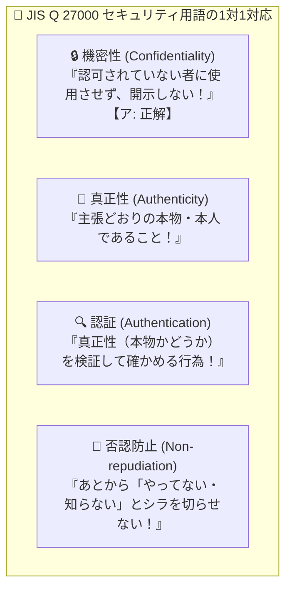

# JIS Q 27000の用語定義：「許可されていない者に見せない・使わせない」＝ 機密性！

> **想定読者**: 機密性、真正性、認証、否認防止のJIS定義文の言い回しで迷う文系受験者
> **省いたもの**: ISO/IEC 27000ファミリー規格の改訂履歴と各附属書の構成
> **所要時間**: 6〜8分
> **対象過去問**: 応用情報技術者 令和5年秋期 問40

---

## 【対象過去問】令和5年秋期 問40

**【問題】**
JIS Q 27000:2019(情報セキュリティマネジメントシステム用語)において，認可されていない個人，エンティティ又はプロセスに対して，情報を使用させず，また，開示しない特性として定義されているものはどれか。

- **ア**: 機密性
- **イ**: 真正性
- **ウ**: 認証
- **エ**: 否認防止

▶ 正解を表示する

**正解: ア（機密性）**

---

## 0. 一枚で：『認可されていない個人・エンティティに情報を使用させず、開示しない特性 ＝ 機密性！』

### 🧠 脳に刻む合言葉：
> **『 「開示しない（秘密にする）」と書いてあったら1秒で『機密性』！ 』**

---

## 1. なぜそうなるのか？（日常のたとえ話：社外秘の封筒。「関係者以外、開封・閲覧厳禁（認可されていない者に開示しない）」というハンコが機密性！）

問題文の日本語をそのまま読めば、1秒で解けるボーナス問題です！

問題文：**「認可されていない個人，エンティティ又はプロセスに対して，情報を使用させず，また，開示しない特性」**
つまり、「許可されていない部外者には、絶対に見せないし（開示しない）、使わせない（秘密を守る）」ということです。

秘密を守る特性といえば、情報セキュリティ3大要素（CIA）の筆頭である **「機密性（Confidentiality）」** ですね！

他の3つの用語もセットで整理しておきましょう：
- **真正性**: エンティティ（人やシステム）が「主張どおりの本物である」という特性。
- **認証**: その真正性が正しいかどうかを「確かめる手続き」。
- **否認防止**: 起きた事象や行動を後から「私はやっていません！」と否定（否認）できないように証明する能力（デジタル署名やログなど）。

---

## 2. 選択肢のひっかけポイント ＆ 判定理由

- **ア: 機密性 【正解！】** → 認可されていない者に対して情報を使用させず、開示しない特性です（◯）。
- **イ: 真正性** → 主張どおりの本物であるという特性です（×）。
- **ウ: 認証** → 主張された特性が正しいことを保証する手続きです（×）。
- **エ: 否認防止** → 事象や行動が起きたことを証明し、後から否認できないようにする能力です（×）。

---

## 3. 午後試験 記述対策チェックリスト（※該当する場合）

- [ ] **Q. デジタル署名やアクセスログの保全によって実現される、「後から送信や操作の事実を否定できなくする」セキュリティ特性を何と呼ぶか？**  
  → **「否認防止（Non-repudiation）。」**

---

## 🎯 次の2分アクション（定着チェック）

- [ ] **画面の一番上に戻り、正解を隠した状態で正解肢「ア」を確信を持って選べるか試してみよう！**
