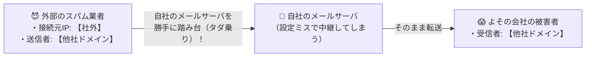

# メールの第三者中継（オープンリレー）：接続元も送信者も宛先も「全部よその会社」のログを探せ！

> **想定読者**: IPアドレスやドメイン名の条件文が長くて、表のどの行を選べばいいか混乱する文系受験者
> **省いたもの**: Postfix等におけるmynetworksおよびrelay_domainsの設定構文
> **所要時間**: 6〜8分
> **対象過去問**: 応用情報技術者 令和5年秋期 問38

---

## 【対象過去問】令和5年秋期 問38

**【問題】**
自社の中継用メールサーバで，接続元IPアドレス，電子メールの送信者のメールアドレスのドメイン名，及び電子メールの受信者のメールアドレスのドメイン名から成るログを取得するとき，外部ネットワークからの第三者中継と判断できるログはどれか。ここで，AAA.168.1.5 と AAA.168.1.10 は自社のグローバルIPアドレスとし，BBB.45.67.89 と BBB.45.67.90 は社外のグローバルIPアドレスとする。a.b.c は自社のドメイン名とし，a.b.d と a.b.e は他社のドメイン名とする。また，IPアドレスとドメイン名は詐称されていないものとする。

- **ア**: 接続元: 自社IP、送信者: 自社ドメイン、受信者: 他社ドメイン（通常の社外への送信）
- **イ**: 接続元: 社外IP、送信者: 他社ドメイン、受信者: 自社ドメイン（通常の社外からの受信）
- **ウ**: 接続元: 社外IP、送信者: 他社ドメイン、受信者: 他社ドメイン（完全無関係な第三者中継！）
- **エ**: 接続元: 自社IP、送信者: 自社ドメイン、受信者: 自社ドメイン（通常の社内メール）

▶ 正解を表示する

**正解: ウ（接続元: 社外IP、送信者: 他社ドメイン、受信者: 他社ドメイン（完全無関係な第三者中継！））**

---

## 0. 一枚で：『接続元IP・送信者ドメイン・受信者ドメインの3つすべてが「社外（他社）」になっている行が第三者中継！』

### 🧠 脳に刻む合言葉：
> **『 第三者中継は「自社と1ミリも関係ないメール」！3項目すべてが『社外・他社』の行を選べば一発正解！ 』**

---

## 1. なぜそうなるのか？（日常のたとえ話：自分の家のポストを、見知らぬ他人Aが見知らぬ他人Bへの手紙の中継ボックスとして勝手に使っている状態！）

「自社のメールサーバ」が、どういうメールを扱うのが正常か考えてみましょう。

1. **社員がよその会社にメールを送る**: 送信者が「自社」
2. **よその会社から社員にメールが届く**: 受信者が「自社」
3. **社員同士でメールする**: 送信者も受信者も「自社」

つまり、まっとうなメールなら **「接続元・送信者・受信者のどれかには、必ず『自社』が入っている」** はずです！

では、**「第三者中継（オープンリレー）」** とは何でしょうか？
よその悪いスパム業者（社外IP・他社ドメイン）が、別のよその人（他社ドメイン）へ迷惑メールを送るときに、うちの会社のメールサーバを勝手に中継地点（踏み台）としてタダ乗りすることです！

だから解き方は超簡単！
問題文の数字を「自社」か「社外（他社）」かに置き換えて、**【接続元：社外】【送信者：他社】【受信者：他社】と3つ全部が「よその人」になっている行（ウ）** を探すだけです！

---

## 2. 選択肢のひっかけポイント ＆ 判定理由

- **ア: 自社が含まれるログ** → 社員からの正常なメール送信などです（×）。
- **イ: 受信者が自社ドメインのログ** → 外部から自社社員宛てに届いた正常な受信メールです（×）。
- **ウ: 接続元IP・送信者ドメイン・受信者ドメインのすべてが社外（他社）であるログ 【正解！】** → 自社と全く無関係な第三者から第三者への不正な中継（オープンリレー）です（◯）。
- **エ: 自社が含まれるログ** → 社内関係の正常な通信です（×）。

---

## 3. 午後試験 記述対策チェックリスト（※該当する場合）

- [ ] **Q. 自社のメールサーバが第三者中継（オープンリレー）を許可する設定になっていた場合、自社が被る具体的な不利益を説明せよ。**  
  → **「迷惑メール（スパム）の踏み台に悪用され、自社メールサーバのIPアドレスがブラックリスト（RBL）に登録されて正規のメールが送信できなくなる。」**

---

## 🎯 次の2分アクション（定着チェック）

- [ ] **画面の一番上に戻り、正解を隠した状態で正解肢「ウ」を確信を持って選べるか試してみよう！**
