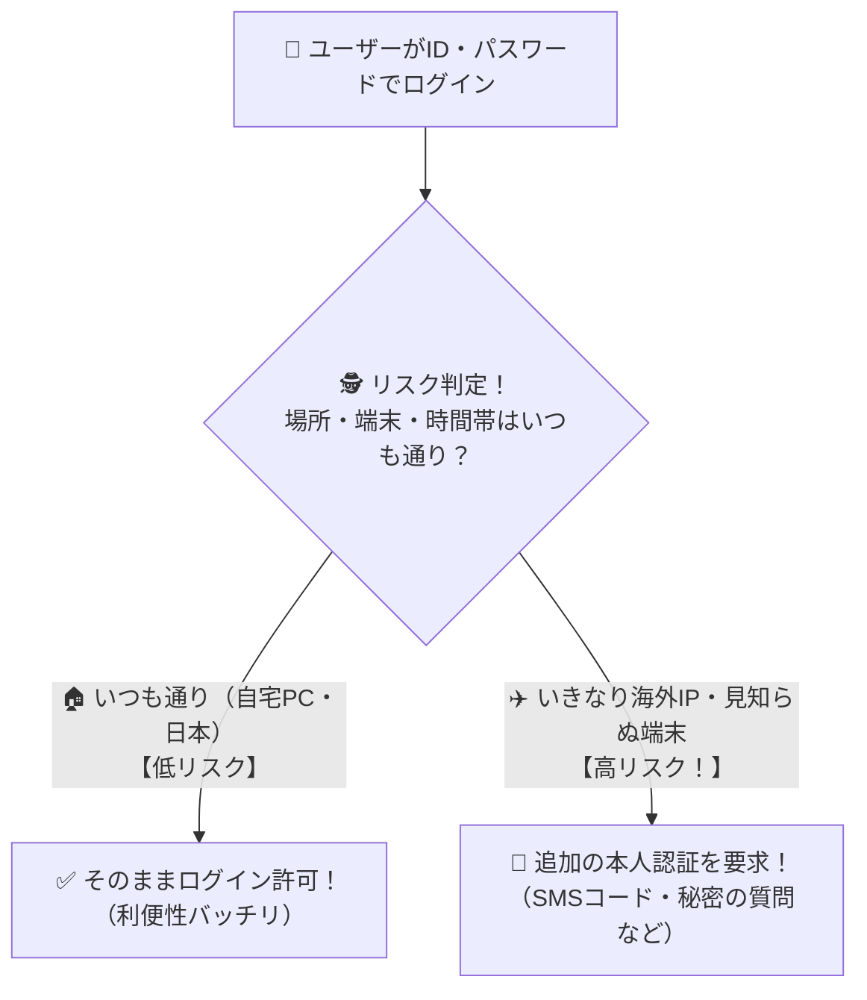

# リスクベース認証：「いつもと違う怪しいログイン」だけ追加質問する賢い警備員！

> **想定読者**: 二要素認証とリスクベース認証の違いが曖昧な文系受験者
> **省いたもの**: 機械学習によるアノマリ検知スコアリングアルゴリズムの内部計算
> **所要時間**: 6〜8分
> **対象過去問**: 応用情報技術者 令和3年春期 問39

---

## 【対象過去問】令和3年春期 問39

**【問題】**
リスクベース認証の特徴はどれか。

- **ア**: いかなる利用条件でのアクセスの要求においても，ハードウェアトークンとパスワードを併用するなど，常に二つの認証方式を併用することによって，不正アクセスに対する安全性を高める。
- **イ**: いかなる利用条件でのアクセスの要求においても認証方法を変更せずに，同一の手順によって普段どおりにシステムにアクセスできるようにし，可用性を高める。
- **ウ**: 普段と異なる利用条件でのアクセスと判断した場合には，追加の本人認証をすることによって，不正アクセスに対する安全性を高める。
- **エ**: 利用者が認証情報を忘れ，かつ，Webブラウザに保存しているパスワード情報も使用できないリスクを想定して，緊急と判断した場合には，認証情報を入力せずに，利用者は普段どおりにシステムを利用できるようにし，可用性を高める。

▶ 正解を表示する

**正解: ウ（普段と異なる利用条件でのアクセスと判断した場合には，追加の本人認証をすることによって，不正アクセスに対する安全性を高める。）**

---

## 0. 一枚で：『普段と異なる利用条件でのアクセスと判断した場合に、追加の本人認証を行う！』

### 🧠 脳に刻む合言葉：
> **『 いつも通りならスルー、怪しい時（高リスク）だけ追加チェックするのが「リスクベース認証」！ 』**

---

## 1. なぜそうなるのか？（日常のたとえ話：マンションのベテラン管理人。毎日見る住人は挨拶だけで通し、深夜にサングラスで裏口から来た人には身分証を求める！）

毎回ログインするたびに「パスワード入れて、SMSの6桁の数字も入れて、秘密の質問も答えて…」とやらされたら、面倒くさくてユーザーは嫌になってしまいますよね。

そこで生まれた賢い仕組みが **リスクベース認証** です！

システムが裏側で「いつも使っているスマホか？」「いつもの場所（日本国内）からのアクセスか？」「いつもの時間帯か？」を分析します。
1. **普段通り（低リスク）**: パスワードだけでサッと通す！（ストレスフリー）
2. **普段と違う（高リスク）**: 「あれ？5分前まで東京にいたのに、急に海外のIPアドレスから初めてのPCでログインしてきたぞ！？」と検知したときだけ、**追加の本人認証（ワンタイムパスワードや合言葉など）** を要求して不正アクセスをブロックします！

---

## 2. 選択肢のひっかけポイント ＆ 判定理由

- **ア: いかなる利用条件でも常に二つの認証方式を併用…** → 常時二要素認証（多要素認証）の説明であり、リスクに応じた切り替えではありません（×）。
- **イ: いかなる利用条件でも認証方法を変更せずに…** → リスク評価を行っていません（×）。
- **ウ: 普段と異なる利用条件でのアクセスと判断した場合には，追加の本人認証をする 【正解！】** → リスクの高さに応じて追加認証を求めるリスクベース認証の特徴です（◯）。
- **エ: 緊急と判断した場合には，認証情報を入力せずに…** → セキュリティが崩壊するため不適切です（×）。

---

## 3. 午後試験 記述対策チェックリスト（※該当する場合）

- [ ] **Q. リスクベース認証を導入することで、常時追加認証を行う方式と比較して得られる利用者側のメリットは何か？**  
  → **「通常の利用環境からのアクセス時には追加認証が省略されるため、利便性を損なわずにセキュリティを高められる。」**

---

## 🎯 次の2分アクション（定着チェック）

- [ ] **画面の一番上に戻り、正解を隠した状態で正解肢「ウ」を確信を持って選べるか試してみよう！**
