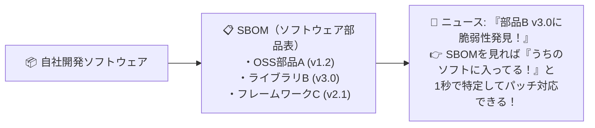

# SBOM（ソフトウェア部品表）：ソフトの中身を丸裸にする「食品の原材料ラベル」！

> **想定読者**: 最新トレンド用語であるSBOM（エスボム）が何をするものかイメージできない文系受験者
> **省いたもの**: SPDXやCycloneDXといったSBOM記述フォーマットの構文仕様
> **所要時間**: 6〜8分
> **対象過去問**: 応用情報技術者 令和7年春期 問40

---

## 【対象過去問】令和7年春期 問40

**【問題】**
ソフトウェアの情報セキュリティ対策のうち，SBOM(Software Bill Of Materials)管理ツールを用いることができるものはどれか。

- **ア**: ソフトウェアでの利用者認証に用いるアカウントの一元管理
- **イ**: ソフトウェアについての脆弱性管理
- **ウ**: ソフトウェアのソースコードについてのバージョン管理，アクセス制御及び改ざん防止
- **エ**: ソフトウェアのソースコードのバックアップとマルウェア混入防止

▶ 正解を表示する

**正解: イ（ソフトウェアについての脆弱性管理）**

---

## 0. 一枚で：『SBOM（ソフトウェア部品表）は、ソフトウェアの「脆弱性管理」に用いる！』

### 🧠 脳に刻む合言葉：
> **『 SBOM（Software Bill Of Materials）＝ ソフトの「原材料表示ラベル」！入ってる部品が分かれば脆弱性管理が爆速！ 』**

---

## 1. なぜそうなるのか？（日常のたとえ話：お菓子の裏の「原材料名ラベル（卵・小麦・乳）」。アレルギー情報（脆弱性）が出たとき、その成分が入っているかすぐ分かる！）

現代のソフトウェア開発では、ゼロから全部自分でプログラムを書くことはなく、世の中にある無料の部品（オープンソースソフトウェア：OSS）を何十個・何百個も組み合わせて作ります。

すると、ある日ニュースで「〇〇という部品に危険な脆弱性（バグ）が見つかりました！」と報じられたとき、
「えっ、うちの会社のシステムにその部品使ってたっけ…？部品のさらに孫部品として紛れ込んでない…？」と調べるのに何週間もかかってしまいます。

そこで作られたのが **SBOM（Software Bill Of Materials：ソフトウェア部品表）** です！
食品のパッケージ裏にある「原材料ラベル」のように、**「このソフトには、どの部品のバージョンいくつが組み込まれているか」を一覧表にして管理** します。
これがあれば、新しい脆弱性情報が出た瞬間に「うちのシステムが影響を受けるか」を即座に突き止めて **脆弱性管理** ができるようになります！

---

## 2. 選択肢のひっかけポイント ＆ 判定理由

- **ア: アカウントの一元管理** → ID管理システム（IAM）やシングルサインオンの説明です（×）。
- **イ: ソフトウェアについての脆弱性管理 【正解！】** → 構成部品を把握することで、脆弱性発見時に影響範囲を迅速に特定・管理できます（◯）。
- **ウ: ソースコードについてのバージョン管理…** → Gitなどのバージョン管理システムの説明です（×）。
- **エ: バックアップとマルウェア混入防止** → バックアップソフトやアンチウイルスソフトの役割です（×）。

---

## 3. 午後試験 記述対策チェックリスト（※該当する場合）

- [ ] **Q. ソフトウェアサプライチェーン攻撃やOSSの脆弱性対応において、SBOMを作成・管理する主な目的を説明せよ。**  
  → **「ソフトウェアに含まれる構成部品や依存関係を可視化し、脆弱性が公表された際の影響有無を迅速に特定するため。」**

---

## 🎯 次の2分アクション（定着チェック）

- [ ] **画面の一番上に戻り、正解を隠した状態で正解肢「イ」を確信を持って選べるか試してみよう！**
