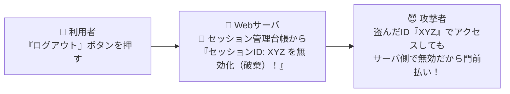

# ログアウト時のセッション対策：ブラウザだけでなく「Webサーバ側の台帳」から無効化せよ！

> **想定読者**: ログアウト処理でサーバ側とブラウザ側のどちらで何を消すべきか迷う文系受験者
> **省いたもの**: JWT（JSON Web Token）等のステートレス認証におけるブラックリスト失効管理の課題
> **所要時間**: 6〜8分
> **対象過去問**: 応用情報技術者 令和3年春期 問44

---

## 【対象過去問】令和3年春期 問44

**【問題】**
Webシステムにおいて，セッションの乗っ取りの機会を減らすために，利用者のログアウト時にWebサーバ又はWebブラウザにおいて行うべき処理はどれか。ここで，利用者は自分専用のPCにおいて，Webブラウザを利用しているものとする。

- **ア**: WebサーバにおいてセッションIDを内蔵ストレージに格納する。
- **イ**: WebサーバにおいてセッションIDを無効にする。
- **ウ**: WebブラウザにおいてキャッシュしているWebページをクリアする。
- **エ**: WebブラウザにおいてセッションIDを内蔵ストレージに格納する。

▶ 正解を表示する

**正解: イ（WebサーバにおいてセッションIDを無効にする。）**

---

## 0. 一枚で：『ログアウト時には、Webサーバ側においてセッションIDを無効にする！』

### 🧠 脳に刻む合言葉：
> **『 ログアウトしたら「サーバ側のセッションIDを無効化」！手元の通行証を捨てるだけじゃダメ、受付の台帳から抹消せよ！ 』**

---

## 1. なぜそうなるのか？（日常のたとえ話：ホテルのチェックアウト。客がカードキーをゴミ箱に捨てるだけでなく、フロントのパソコン側で「そのカードキーではドアが開かないように無効化」するのが絶対条件！）

ホテルからチェックアウト（ログアウト）するときのことを考えてみてください。

もしフロント（Webサーバ）がカードキーの有効期限を切らずに放置していたら、あなたが帰った後に誰かがそのカードキー（セッションID）を拾って、勝手に部屋に入り込めてしまいますよね！

Webシステムでも全く同じです。
利用者が「ログアウト」ボタンを押したとき、ブラウザ側の画面を消すだけでは不十分です。すでに通信途中でセッションIDを盗み見られているかもしれないからです。
最も確実で必須な処理は、**「Webサーバ側において、そのセッションIDを即座に無効化する（破棄する）」** ことです！こうすれば、万が一セッションIDが盗まれていても、攻撃者は二度と使えません。

---

## 2. 選択肢のひっかけポイント ＆ 判定理由

- **ア: WebサーバにおいてセッションIDを内蔵ストレージに格納する** → 保存し続けたら乗っ取りの危険が残ります。破棄（無効化）すべきです（×）。
- **イ: WebサーバにおいてセッションIDを無効にする 【正解！】** → サーバ側でセッションを破棄・無効化することで、盗まれたセッションIDの悪用を完全に防げます（◯）。
- **ウ: WebブラウザにおいてキャッシュしているWebページをクリアする** → 画面キャッシュを消しても、サーバ側でセッションIDが有効なままなら通信の乗っ取りは防げません（×）。
- **エ: WebブラウザにおいてセッションIDを内蔵ストレージに格納する** → 格納して残してはいけません（×）。

---

## 3. 午後試験 記述対策チェックリスト（※該当する場合）

- [ ] **Q. 利用者が明示的にログアウト操作を行わずにブラウザを閉じた場合に備え、Webサーバ側でセッション乗っ取りリスクを低減するために設定すべき仕組みは何か？**  
  → **「一定時間通信がないセッションIDを自動的に無効化するセッションタイムアウトの設定。」**

---

## 🎯 次の2分アクション（定着チェック）

- [ ] **画面の一番上に戻り、正解を隠した状態で正解肢「イ」を確信を持って選べるか試してみよう！**
