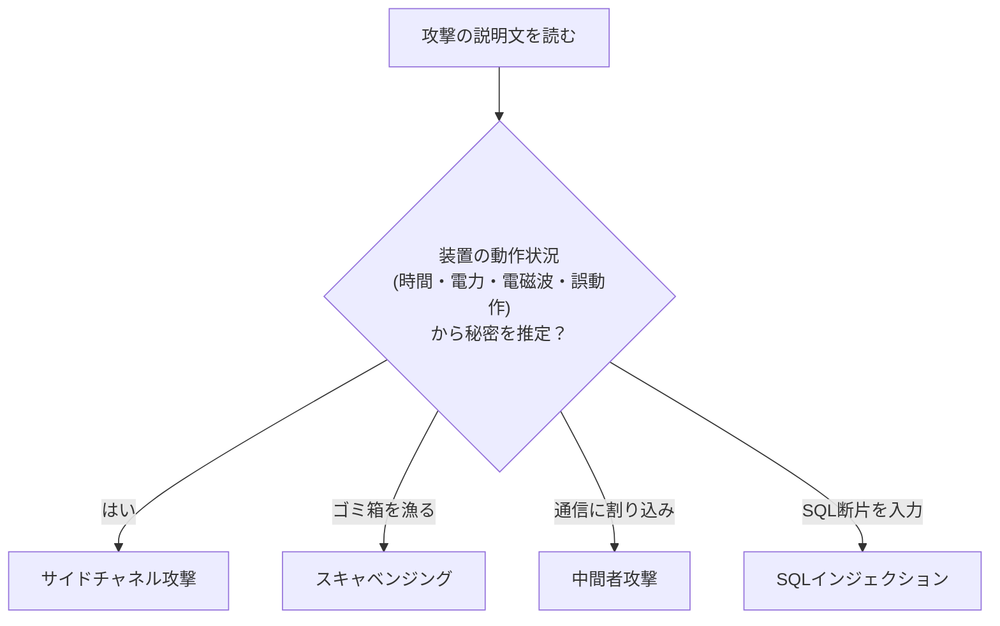

# タイトル：【金庫破りの聞き耳】で覚える「サイドチャネル攻撃」

> **想定読者**: 攻撃手法の名前と説明が一致せず迷う文系受験者  
> **省いたもの**: 電力解析の統計処理（DPA/SPA）の数理  
> **所要時間**: 6〜8分  
> **対象過去問**: 応用情報技術者 [令和4年秋期 午前問37](https://www.ap-siken.com/kakomon/04_aki/q37.html)  

---

## 【対象過去問】令和4年秋期 午前問37

**【問題】**  
サイドチャネル攻撃に該当するものはどれか。

- **ア**: 暗号アルゴリズムを実装した攻撃対象の物理デバイスから得られる物理量(処理時間，消費電流など)やエラーメッセージから，攻撃対象の秘密情報を得る。
- **イ**: 企業などの秘密情報を不正に取得するソーシャルエンジニアリングの手法の一つであり，不用意に捨てられた秘密情報の印刷物をオフィスの紙ごみの中から探し出す。
- **ウ**: 通信を行う2者間に割り込み，両者が交換する情報を自分のものとすり替えることによって，その後の通信を気付かれることなく盗聴する。
- **エ**: データベースを利用するWebサイトに入力パラメータとしてSQL文の断片を送信することによって，データベースを改ざんする。

▶ 正解を表示する

**正解: ア（物理量やエラーメッセージから秘密情報を得る）**

---

## 0. 一枚で：「正面（暗号そのもの）ではなく、横（動作の様子）から探る」！

**合言葉：『鍵は壊さず、音と熱と時間を盗む』**

---

## 1. なぜそうなるのか？（日常のたとえ話）

ダイヤル式金庫を破りたい泥棒を考えます。正面から数字を総当たりするのは大変です。そこで **金庫に耳を当てて、カチッという音の違い** を聞き取る。これがサイドチャネル（Side Channel＝本来の入出力ではない **脇の経路**）攻撃です。暗号の数学的な強さではなく、**装置が動くときに漏れる情報** を狙います。

公式解説では、サイドチャネル攻撃は対象の動作状況を観察し、漏洩電磁波・電力消費等から暗号鍵推定等を行う **非破壊型解析攻撃の総称** です。代表的な手法：

| 手法 | 内容 |
|---|---|
| 故障利用攻撃 | デバイスに限定的な障害を故意に与え、計算誤りから秘密情報を解析 |
| タイミング攻撃 | 暗号処理の時間が鍵の論理値に依存して変わることに着目し、所要時間の差を統計的に解析して鍵を推定 |
| 電力解析攻撃 | 消費電力の変化から鍵や処理内容を解析 |
| 電磁波解析攻撃（テンペスト攻撃） | 機器が発する電磁波を測定して秘密情報を取得 |

---

## 2. 選択肢のひっかけポイント ＆ 判定表

| 選択肢 | 判定 | 理由（公式解説） |
|---|---|---|
| ア | ○ | 処理時間・消費電流などの物理量やエラーメッセージから秘密情報を得る、サイドチャネル攻撃の説明。 |
| イ | ✕ | **スキャベンジング** の説明（ごみ漁り型のソーシャルエンジニアリング）。 |
| ウ | ✕ | **MITM攻撃（中間者攻撃）** の説明。 |
| エ | ✕ | **SQLインジェクション** の説明。 |

**ひっかけ**: イ〜エは、どれもセキュリティ試験の頻出用語で、「攻撃っぽいから」と選びやすい。決め手は **「暗号の実装機器の物理的な様子を観察する」** という一点。ちなみにアの「エラーメッセージ」も、装置から漏れる情報として含まれる点に注意。

---

## 🎯 次の2分アクション（定着チェック）

- [ ] **画面の一番上に戻り、正解を隠した状態で正解肢を確信を持って選べるか試してみよう！**
- [ ] 表の4手法（故障・タイミング・電力・電磁波）を指で隠して言えるか確認。
