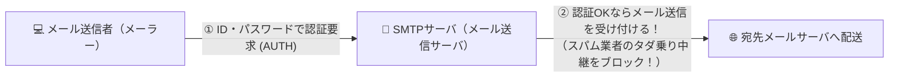

# SMTP-AUTH：メールを送る前に「まずIDとパスワードを見せて！」と確認する門番！

> **想定読者**: SMTP-AUTH、POP before SMTP、S/MIME、APOPの違いがごちゃ混ぜになる文系受験者
> **省いたもの**: SASL（Simple Authentication and Security Layer）におけるCRAM-MD5やPLAINのコマンドシーケンス
> **所要時間**: 6〜8分
> **対象過去問**: 応用情報技術者 平成26年秋期 問37

---

## 【対象過去問】平成26年秋期 問37

**【問題】**
SMTP-AUTHにおける認証の動作を説明したものはどれか。

- **ア**: SMTPサーバは，クライアントがアクセスしてきた場合に利用者認証を行い，認証が成功したとき電子メールを受け付ける。
- **イ**: サーバは認証局のデジタル証明書をもち，クライアントから送信された認証局の署名付きクライアント証明書の妥当性を確認する。
- **ウ**: 電子メールを受信した際にパスワード認証が成功したクライアントのIPアドレスは，一定時間だけSMTPサーバへの電子メールの送信が許可される。
- **エ**: パスワードを秘匿するために，パスワードからハッシュ値を計算して，その値で利用者が電子メールを受信する際の利用者認証を行う。

▶ 正解を表示する

**正解: ア（SMTPサーバは，クライアントがアクセスしてきた場合に利用者認証を行い，認証が成功したとき電子メールを受け付ける。）**

---

## 0. 一枚で：『SMTPサーバはクライアント接続時に利用者認証を行い、成功したときだけメール送信を受け付ける！』

### 🧠 脳に刻む合言葉：
> **『 SMTP-AUTHは「SMTP（送信）でそのままAUTH（認証）する」！受信用POPを使わない直球勝負！ 』**

---

## 1. なぜそうなるのか？（日常のたとえ話：会員制の宅配便受付。荷物を預かる窓口（SMTPサーバ）で、直接「会員証と暗証番号」をチェックしてから荷物を受け取る！）

昔、メールを送るプロトコル（SMTP）には「誰が送ってきたか確認する（認証する）機能」がありませんでした。そのため、スパム業者が他人のメールサーバを勝手に使って迷惑メールを大量送信する「第三者中継」が大問題になりました。

これを防ぐために作られた現在の標準方式が **SMTP-AUTH（エスエムティーピー・オース）** です！
名前の通り、**「SMTPサーバ（送信サーバ）自身が、アクセスしてきたクライアントに対してID・パスワード等で利用者認証を行い、認証に成功した人のメールだけを受け付ける」** という、とてもシンプルで真っ当な仕組みです。

※他の選択肢との見分け方：
- 「先にメールを受信（POP）させて、そのIPアドレスを一定時間だけ送信許可する」→ **POP before SMTP**（昔の方式）
- 「受信時にパスワードのハッシュ値を送る」→ **APOP**

---

## 2. 選択肢のひっかけポイント ＆ 判定理由

- **ア: SMTPサーバは，クライアントがアクセスしてきた場合に利用者認証を行い，認証が成功したとき電子メールを受け付ける 【正解！】** → SMTP-AUTHの正確な動作説明です（◯）。
- **イ: クライアント証明書の妥当性を確認する** → TLSクライアント認証の説明です（×）。
- **ウ: 受信した際に認証成功したIPアドレスを一定時間だけ送信許可する** → POP before SMTPの説明です（×）。
- **エ: パスワードからハッシュ値を計算して電子メールを受信する際の認証を行う** → APOP（POP3受信時の認証）の説明です（×）。

---

## 3. 午後試験 記述対策チェックリスト（※該当する場合）

- [ ] **Q. 外部のネットワークから自社のSMTPサーバを利用してメールを送信する際、従来使われていた25番ポートに代わり、SMTP-AUTHと組み合わせて利用される専用ポート（587番）を何と呼ぶか？**  
  → **「サブミッションポート（Submission Port）。」**

---

## 🎯 次の2分アクション（定着チェック）

- [ ] **画面の一番上に戻り、正解を隠した状態で正解肢「ア」を確信を持って選べるか試してみよう！**
