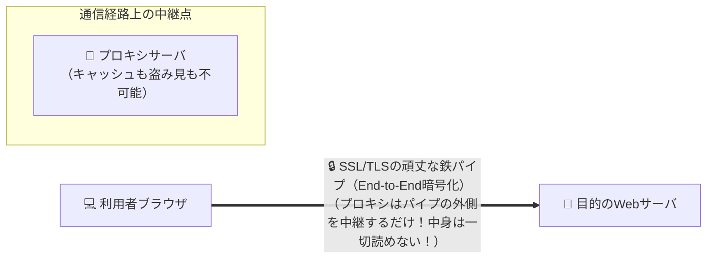

# SSL/TLSとプロキシ：途中に中継所（プロキシ）があっても、トンネルの中身は絶対に見えない！

> **想定読者**: プロキシサーバを通るとSSLの暗号化が解けて中身が見られてしまうと誤解している文系受験者
> **省いたもの**: HTTP CONNECTメソッドによるトンネリング確立シーケンスと企業内SSLインスペクションの例外構成
> **所要時間**: 6〜8分
> **対象過去問**: 応用情報技術者 平成17年秋期 問76

---

## 【対象過去問】平成17年秋期 問76

**【問題】**
ブラウザからWebサーバにアクセスするシステムのセキュリティに関する記述のうち，適切なものはどれか。

- **ア**: CGI又はサーブレットによって生成されたHTML文書は動的に変化するので，プロキシサーバでのキャッシュの内容が，本来の利用者以外に開示されることはない。
- **イ**: SSLを使用すれば，通信経路上にプロキシサーバが存在していても，各利用者とWebサーバとの間での参照情報が，本来の利用者以外に開示されることはない。
- **ウ**: 複数の利用者が同一のパソコンを利用する場合，最初にHTTP基本認証を利用したログイン操作を行うようにすれば，ブラウザを起動したまま利用者が交代しても，本来の利用者以外に情報が開示されることはない。
- **エ**: リバースプロキシは静的コンテンツのキャッシュができないので，それを使ってもクライアントへの応答時間が改善されることはない。

▶ 正解を表示する

**正解: イ（SSLを使用すれば，通信経路上にプロキシサーバが存在していても，各利用者とWebサーバとの間での参照情報が，本来の利用者以外に開示されることはない。）**

---

## 0. 一枚で：『SSL/TLSを使えば、経路上にプロキシサーバがあっても参照情報が他人に漏れることはない！』

### 🧠 脳に刻む合言葉：
> **『 SSL/TLSは「ブラウザからWebサーバまで直通の暗号トンネル」！途中のプロキシにも中身は一切見えない！ 』**

---

## 1. なぜそうなるのか？（日常のたとえ話：鍵付きのアタッシュケース。途中の郵便局（プロキシ）はケースを運ぶだけで、中の手紙を読むこともコピーすることもできない！）

社内やプロバイダに「プロキシサーバ（代理中継サーバ）」がある環境で、Webサイトを見る場面です。

普通の暗号化されていない通信（HTTP）だと、プロキシサーバは中身を丸見えで読めるため、ページを勝手に保存（キャッシュ）して別の人に見せてしまう事故が起きることがあります。

しかし、**SSL/TLS（HTTPS）** を使うとどうなるでしょうか？
SSLは、プロキシサーバに対して「`CONNECT`（ただ土管を繋いでくれ！）」と命じ、**利用者のブラウザと最終目的地のWebサーバの間で直接、鍵のかかった暗号化トンネル** を作ります。
途中にいるプロキシサーバは、暗号化されたデータの塊を右から左へ受け流すだけで、中身を復号する鍵を持っていません。
だから、**プロキシサーバ上に情報がキャッシュされて他人に漏れることは絶対にありません！**

---

## 2. 選択肢のひっかけポイント ＆ 判定理由

- **ア: CGIやサーブレットで生成された文書はプロキシで開示されることはない** → ヘッダ設定によっては動的ページでもプロキシにキャッシュされ、他人に開示される危険があります（×）。
- **イ: SSLを使用すれば，プロキシサーバが存在していても，参照情報が本来の利用者以外に開示されることはない 【正解！】** → エンドツーエンドで暗号化されるため、プロキシでも中身は読めずキャッシュもされません（◯）。
- **ウ: 最初にHTTP基本認証を行えば，ブラウザを起動したまま交代しても開示されない** → ブラウザを閉じずに交代すると、認証情報がメモリに残り前任者の権限で閲覧されてしまいます（×）。
- **エ: リバースプロキシは静的コンテンツのキャッシュができない** → リバースプロキシは静的コンテンツのキャッシュによる応答高速化が得意です（×）。

---

## 3. 午後試験 記述対策チェックリスト（※該当する場合）

- [ ] **Q. 通常のプロキシサーバを経由してHTTPS通信を行う際、プロキシサーバ上で通信内容が盗聴・キャッシュされない理由を説明せよ。**  
  → **「クライアントとWebサーバ間でエンドツーエンドのSSL/TLS暗号化通信が行われ、プロキシは暗号化されたデータをそのまま中継するだけであるため。」**

---

## 🎯 次の2分アクション（定着チェック）

- [ ] **画面の一番上に戻り、正解を隠した状態で正解肢「イ」を確信を持って選べるか試してみよう！**
