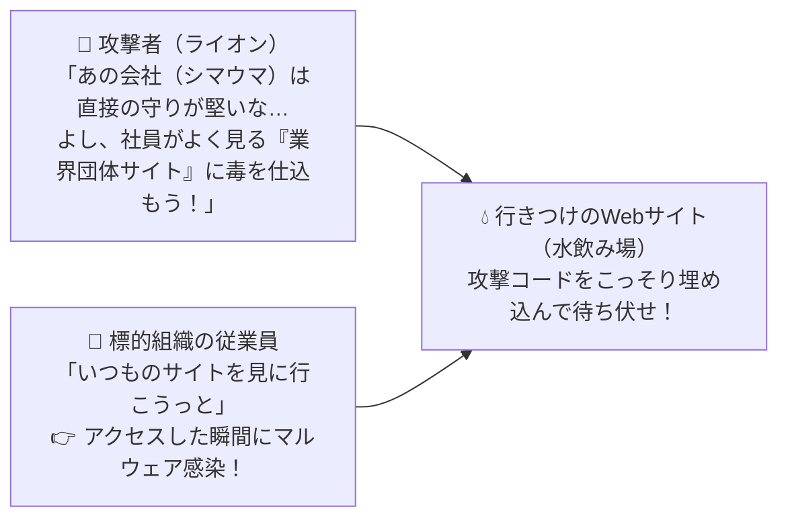

# 水飲み場型攻撃：獲物（標的社員）が毎日見に行く「行きつけのWebサイト」に罠を張る！

> **想定読者**: 標的型メール攻撃、やり取り型攻撃、水飲み場型攻撃の区別がつかない文系受験者
> **省いたもの**: ドライブバイダウンロード攻撃におけるブラウザ脆弱性エクスプロイトキットの動作詳細
> **所要時間**: 6〜8分
> **対象過去問**: 応用情報技術者 平成29年春期 問40

---

## 【対象過去問】平成29年春期 問40

**【問題】**
水飲み場型攻撃(Watering Hole Attack)の手口はどれか。

- **ア**: アイコンを文書ファイルのものに偽装した上で，短いスクリプトを埋め込んだショートカットファイル(LNKファイル)を電子メールに添付して標的組織の従業員に送信する。
- **イ**: 事務連絡などのやり取りを行うことで，標的組織の従業員の気を緩めさせ，信用させた後，攻撃コードを含む実行ファイルを電子メールに添付して送信する。
- **ウ**: 標的組織の従業員が頻繁にアクセスするWebサイトに攻撃コードを埋め込み，標的組織の従業員がアクセスしたときだけ攻撃が行われるようにする。
- **エ**: ミニブログのメッセージにおいて，ドメイン名を短縮してリンク先のURLを分かりにくくすることによって，攻撃コードを埋め込んだWebサイトに標的組織の従業員を誘導する。

▶ 正解を表示する

**正解: ウ（標的組織の従業員が頻繁にアクセスするWebサイトに攻撃コードを埋め込み，標的組織の従業員がアクセスしたときだけ攻撃が行われるようにする。）**

---

## 0. 一枚で：『標的組織の従業員が頻繁にアクセスするWebサイトを改ざんして攻撃コードを埋め込む手口！』

### 🧠 脳に刻む合言葉：
> **『 ライオンが水飲み場でシマウマを待ち伏せするように、「標的がよく行くWebサイト」に罠を仕掛けるのが水飲み場型攻撃！ 』**

---

## 1. なぜそうなるのか？（日常のたとえ話：サバンナの狩り。警戒心の強いシマウマを追いかけ回すのではなく、シマウマが必ず水を飲みに来るオアシス（よく見るサイト）で待ち伏せする！）

なぜ「水飲み場型攻撃（Watering Hole Attack）」という面白い名前がついているのでしょうか？
アフリカのサバンナで、ライオン（攻撃者）がシマウマ（標的の会社）を狩るときの様子をイメージしてください。

大企業はメールの警戒が厳しく、怪しい添付ファイル付きメール（標的型メール）を送ってもなかなか開いてくれません。
そこで攻撃者は考えました。
「あの会社の社員たちが、仕事で毎日必ず見に行く『業界団体のホームページ』や『行きつけの専門サイト（＝水飲み場）』があるはずだ！そのWebサイトの方を先にハッキングして、ウイルスを仕込んでおこう！」

すると、標的の社員が「いつものサイトを見よう」とアクセスしただけで、自動的にウイルスに感染してしまいます。
このように **「標的が頻繁にアクセスするWebサイトに攻撃コードを埋め込んで待ち伏せする手口」** が水飲み場型攻撃です！

---

## 2. 選択肢のひっかけポイント ＆ 判定理由

- **ア: ショートカットファイル(LNK)をメールに添付して送信…** → 標的型攻撃メールの手口です（×）。
- **イ: 事務連絡などのやり取りで信用させた後，実行ファイルをメール添付…** → やり取り型（対話型）の標的型攻撃メールの手口です（×）。
- **ウ: 標的組織の従業員が頻繁にアクセスするWebサイトに攻撃コードを埋め込み… 【正解！】** → 水飲み場（よく訪れるサイト）で待ち伏せする水飲み場型攻撃の手口です（◯）。
- **エ: ドメイン名を短縮してURLを分かりにくくし誘導…** → 短縮URLを悪用したフィッシングやSNS誘導の手口です（×）。

---

## 3. 午後試験 記述対策チェックリスト（※該当する場合）

- [ ] **Q. 水飲み場型攻撃によるマルウェア感染を防ぐために、標的となる企業側のクライアントPCおよびネットワークで実施すべき対策を答えよ。**  
  → **「OSやWebブラウザ・プラグインの脆弱性パッチを最新に保つこと、およびWebプロキシ等での不正プログラム検知・遮断。」**

---

## 🎯 次の2分アクション（定着チェック）

- [ ] **画面の一番上に戻り、正解を隠した状態で正解肢「ウ」を確信を持って選べるか試してみよう！**
