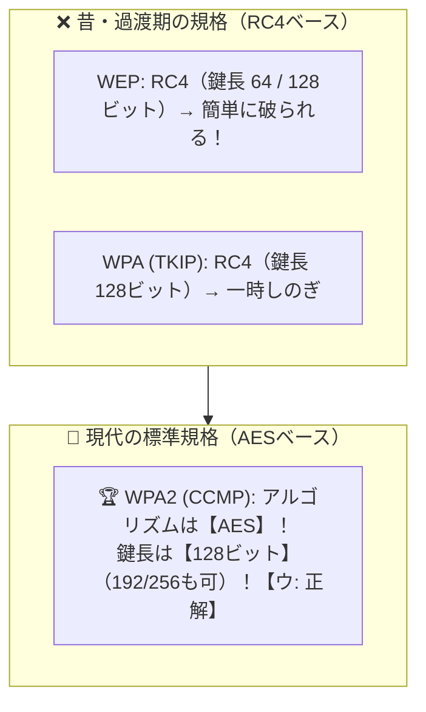

# 無線LANの暗号規格：最強タッグは「WPA2 ＋ AES（CCMP）＋ 鍵長128ビット以上」！

> **想定読者**: WEP、WPA、WPA2とRC4、TKIP、CCMP、AESの組み合わせ表で頭がパンクする文系受験者
> **省いたもの**: WPA3におけるSAE（Simultaneous Authentication of Equals）ハンドシェイクの数理
> **所要時間**: 6〜8分
> **対象過去問**: 応用情報技術者 平成30年秋期 問45

---

## 【対象過去問】平成30年秋期 問45

**【問題】**
無線LANのセキュリティプロトコル，暗号アルゴリズム，暗号鍵の鍵長の組合せのうち，適切なものはどれか。

- **ア**: プロトコル: WPA、アルゴリズム: AES、鍵長: 64ビット
- **イ**: プロトコル: WPA、アルゴリズム: RC4、鍵長: 256ビット
- **ウ**: プロトコル: WPA2、アルゴリズム: AES、鍵長: 128ビット
- **エ**: プロトコル: WPA2、アルゴリズム: RC4、鍵長: 64ビット

▶ 正解を表示する

**正解: ウ（プロトコル: WPA2、アルゴリズム: AES、鍵長: 128ビット）**

---

## 0. 一枚で：『WPA2-AES（CCMP）は暗号アルゴリズムに「AES」を使い、鍵長は「128ビット（以上）」！』

### 🧠 脳に刻む合言葉：
> **『 「WEP・TKIPは古いRC4」「WPA2（CCMP）は最強のAES（128ビット）」！AESで64ビットは存在しない！ 』**

---

## 1. なぜそうなるのか？（日常のたとえ話：家の鍵の進化。針金で開く古い南京錠（WEP/RC4）から、ピッキング不可能なディンプルキー（WPA2/AES 128ビット）へ！）

Wi-Fi（無線LAN）の暗号化の歴史は、3ステップで整理するとスッキリ頭に入ります！

1. **第1世代：WEP（ウェップ）**
   `RC4` という古い暗号方式を使っていました（鍵長64ビットまたは128ビット）。今は数分で解読されるため使用厳禁です。

2. **第2世代：WPA（TKIP）**
   機械を買い替えずにWEPの弱点を応急処置した規格です。中身は相変わらず `RC4`（鍵長128ビット）です。

3. **第3世代：WPA2（CCMP）**
   ここから暗号方式がガラッと変わり、アメリカ政府標準の超強力な共通鍵暗号 **`AES`** が採用されました！
   **AESの鍵長は「128ビット・192ビット・256ビット」の3種類** と決まっています（64ビットなんて短い鍵はAESには存在しません！）。

したがって、正しい組み合わせは **「WPA2 － AES － 128ビット」** です！

---

## 2. 選択肢のひっかけポイント ＆ 判定理由

- **ア: WPA / AES / 64ビット** → AESの鍵長は128/192/256ビットであり、64ビットは存在しません（×）。
- **イ: WPA / RC4 / 256ビット** → WPA(TKIP)のRC4暗号鍵は128ビットです（×）。
- **ウ: WPA2 / AES / 128ビット 【正解！】** → WPA2(CCMP)はAESを採用し、128ビットの鍵長を使用します（◯）。
- **エ: WPA2 / RC4 / 64ビット** → WPA2の標準(CCMP)はRC4ではなくAESです（×）。

---

## 3. 午後試験 記述対策チェックリスト（※該当する場合）

- [ ] **Q. 無線LANのセキュリティ規格であるWPA2（CCMP）において採用されている共通鍵暗号アルゴリズムの名称を答えよ。**  
  → **「AES。」**

---

## 🎯 次の2分アクション（定着チェック）

- [ ] **画面の一番上に戻り、正解を隠した状態で正解肢「ウ」を確信を持って選べるか試してみよう！**
