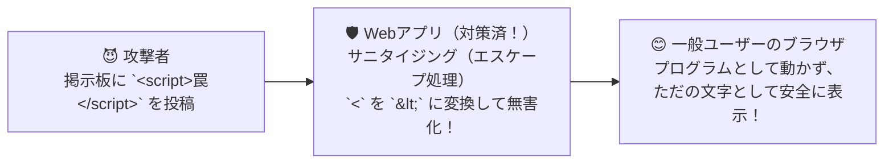

# クロスサイトスクリプティング（XSS）対策：悪意あるスクリプトを無害化する「毒抜き調理」！

> **想定読者**: XSS、SQLインジェクション、バッファオーバーフローの対策がごちゃ混ぜになる文系受験者
> **省いたもの**: DOM Based XSSにおけるJavaScriptフレームワーク内部の仮想DOMエスケープ機構
> **所要時間**: 6〜8分
> **対象過去問**: 応用情報技術者 平成18年秋期 問76

---

## 【対象過去問】平成18年秋期 問76

**【問題】**
クロスサイトスクリプティングによる攻撃へのセキュリティ対策はどれか。

- **ア**: OSのセキュリティパッチを適用することによって，Webサーバへの侵入を防止する。
- **イ**: Webアプリケーションで，クライアントに入力データを再表示する場合，情報内のスクリプトを無効にする処理を行う。
- **ウ**: WebサーバにSNMPプログラムを常駐稼動させることによって，攻撃を検知する。
- **エ**: 許容範囲を超えた大きさのデータの書き込みを禁止し，Webサーバへの侵入を防止する。

▶ 正解を表示する

**正解: イ（Webアプリケーションで，クライアントに入力データを再表示する場合，情報内のスクリプトを無効にする処理を行う。）**

---

## 0. 一枚で：『入力データを画面に再表示する際、スクリプト（HTML特殊文字）を無効化する処理を行う！』

### 🧠 脳に刻む合言葉：
> **『 XSSは「画面表示時のスクリプト発火」！対策は「表示する時にタグを無効化（サニタイジング）」！ 』**

---

## 1. なぜそうなるのか？（日常のたとえ話：フグの毒抜き調理。お客さんのテーブル（ブラウザ）に出す直前に、毒（スクリプトタグ）を無害な文字に取り除く！）

掲示板や検索画面で、ユーザーが入力した文字をそのまま「〇〇を検索しました」と画面に再表示するWebサイトがありますよね。

もし悪い人が、検索窓に普通の言葉ではなく **``** というプログラムの呪文を入力したらどうなるでしょうか？
何も対策していないと、それを見た他の人のブラウザが「あ、プログラムの命令だ！」と勘違いして実行してしまい、個人情報が盗まれてしまいます。これが **クロスサイトスクリプティング（XSS）** です。

対策はシンプルです！
ブラウザに文字を再表示する際、`<` や `>` といったタグ記号をただの文字（`&lt;` や `&gt;`）に変換して、**「スクリプトとして動かないように無効化（エスケープ／サニタイジング）」** してあげれば、ただの文字列として安全に表示されます！

---

## 2. 選択肢のひっかけポイント ＆ 判定理由

- **ア: OSのセキュリティパッチを適用…** → OSの脆弱性対策であり、Webアプリ固有のXSS対策にはなりません（×）。
- **イ: クライアントに入力データを再表示する場合，情報内のスクリプトを無効にする処理を行う 【正解！】** → エスケープ（サニタイジング）処理と呼ばれるXSSの王道対策です（◯）。
- **ウ: SNMPプログラムを常駐稼動…** → SNMPはネットワーク機器監視用であり、XSS検知とは無関係です（×）。
- **エ: 許容範囲を超えた大きさのデータの書き込みを禁止…** → バッファオーバーフロー攻撃への対策です（×）。

---

## 3. 午後試験 記述対策チェックリスト（※該当する場合）

- [ ] **Q. クロスサイトスクリプティング（XSS）を防ぐため、Webページに入力値を出力する際に `<` や `>` などの特殊文字を文字参照に変換する処理を何と呼ぶか？**  
  → **「エスケープ処理（またはサニタイジング処理）。」**

---

## 🎯 次の2分アクション（定着チェック）

- [ ] **画面の一番上に戻り、正解を隠した状態で正解肢「イ」を確信を持って選べるか試してみよう！**
