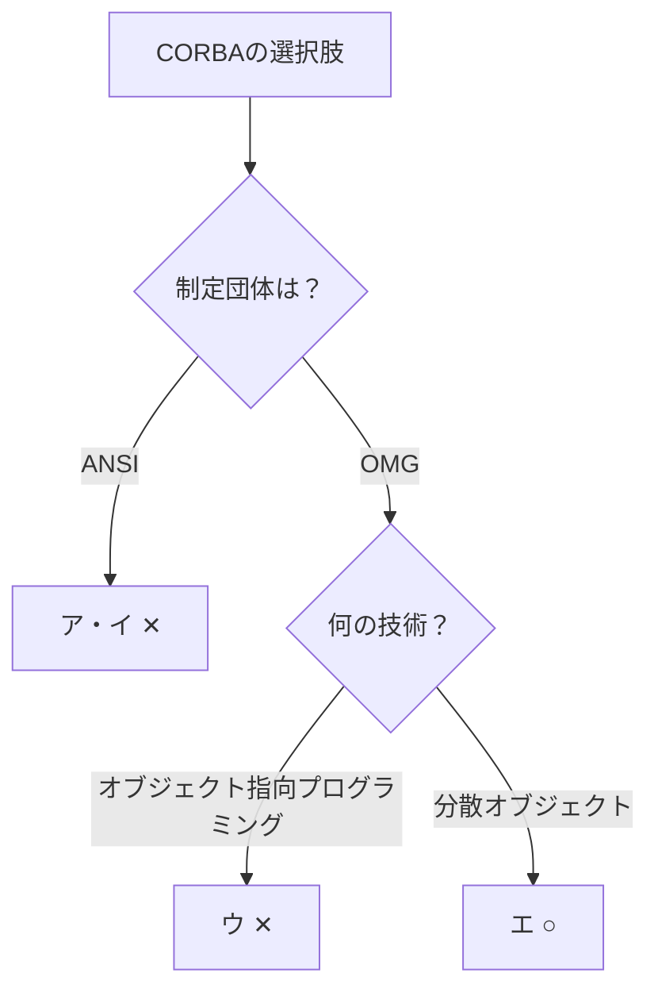

# CORBA：国連の通訳窓口で覚える「OMGが決めた分散オブジェクトの仕様」

> **想定読者**: ANSI・OMG・ISOなど標準化団体の名前がごちゃ混ぜになる文系受験者  
> **省いたもの**: IDLやORBの内部実装の詳細  
> **所要時間**: 6〜8分  
> **対象過去問**: 応用情報技術者 平成19年春期 問80  

---

## 【対象過去問】平成19年春期 問80

**【問題】**  
CORBAを説明したものはどれか。

- **ア**: ANSIが制定したオブジェクト指向プログラミング技術の仕様
- **イ**: ANSIが制定した分散オブジェクト技術の仕様
- **ウ**: OMGが制定したオブジェクト指向プログラミング技術の仕様
- **エ**: OMGが制定した分散オブジェクト技術の仕様

▶ 正解を表示する

**正解: エ（OMGが制定した分散オブジェクト技術の仕様）**

---

## 0. 一枚で：「誰が？（OMG）」×「何の？（分散オブジェクト）」の2軸で消去！

### 🧠 脳に刻む合言葉：
> **『 CORBAは OMG（オブジェクト団体）の 分散オブジェクト仕様！ 』**

---

## 1. なぜそうなるのか？（日常のたとえ話：国際会議の同時通訳ブース）

世界中から集まった人が、それぞれ違う言語（プログラム言語）、違う場所（コンピュータ）にいても会話したい。そこで**共通の通訳ブース（ORB）**を挟み、誰が話しても相手に伝わるようにしたのがCORBAです。

- 正式名：Common Object Request Broker Architecture
- 制定団体：OMG（Object Management Group）＝オブジェクト指向技術の標準化団体
- 目的：様々なコンピュータ上で、様々なプログラム言語で書かれたソフトウェア部品（コンポーネント）を相互に利用できる**分散処理環境**を実現すること（公式解説）

つまり「プログラムの書き方」ではなく、**離れた場所にあるオブジェクト同士を呼び出し合う仕組み**の標準仕様です。

---

## 2. 選択肢のひっかけポイント ＆ 判定理由

- **ア ✕**: 制定団体がANSI（米国規格協会）で誤り。さらに「オブジェクト指向プログラミング技術」ではなく「分散オブジェクト技術」なので二重に誤り。
- **イ ✕**: 技術内容（分散オブジェクト）は正しいが、制定団体がANSIで誤り。**半分だけ正しいひっかけ**。
- **ウ ✕**: 制定団体（OMG）は正しいが、「オブジェクト指向プログラミング技術」が誤り。CORBAは言語の仕様ではなく、分散環境でオブジェクトを相互利用する仕様。
- **エ ○**: OMG（団体）＋分散オブジェクト技術（目的）の両方が正しい。

> 😈 最大のトラップ：イとウは「片方だけ正しい」選択肢。**団体名と技術内容の両方を確認**してから選びましょう。

> ※元データの分類は「法務」ですが、内容は分散オブジェクト技術（開発技術）のため、12_システム開発技術に配置しました。

---

## 🎯 次の2分アクション（定着チェック）

- [ ] **画面の一番上に戻り、正解を隠した状態で正解肢「エ」を確信を持って選べるか試してみよう！**
- [ ] 「CORBA＝OMG＝分散オブジェクト」を声に出して3回言ってみよう。
