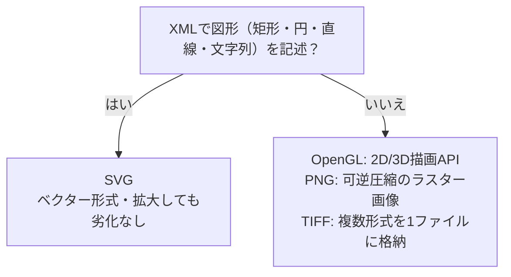

# 画像フォーマットSVG：「設計図で描く絵」で覚える「拡大しても荒れないXML画像」

> **想定読者**: PNG・TIFF・SVG・OpenGLの違いが混ざる文系受験者  
> **省いたもの**: SVGの詳細な記述文法やアニメーション仕様  
> **所要時間**: 6〜8分  
> **対象過去問**: 応用情報技術者 令和3年春期 午前問27  

---

## 【対象過去問】令和3年春期 問27

**【問題】**  
W3Cで仕様が定義され，矩形や円，直線，文字列などの図形オブジェクトをXML形式で記述し，Webページでの図形描画にも使うことができる画像フォーマットはどれか。

- **ア**: OpenGL
- **イ**: PNG
- **ウ**: SVG
- **エ**: TIFF

▶ 正解を表示する

**正解: ウ（SVG）**

---

## 0. 一枚で：「XMLで書く」「図形を命令で描く」＝SVG！

### 🧠 脳に刻む合言葉：
> **『 SVG＝ベクター＋XML＋拡大しても荒れない！ 』**

---

## 1. なぜそうなるのか？（日常のたとえ話：絵と設計図の違い）

- **PNGなどのラスター画像** ＝ **モザイクタイルの壁画**。1マスずつ色を並べた絵なので、近づいて拡大するとマスが見えて荒れる。
- **SVG（ベクター画像）** ＝ **「ここに半径3cmの赤い円を描く」という設計図**。拡大しても、設計図から描き直すので**常にくっきり**。

SVG（Scalable Vector Graphics）は、ベクター形式による2次元の画像・図形・テキストなどを**XML形式で記述する**画像フォーマットです。公式解説では、次の特徴が挙げられています。

- 拡大・縮小しても画質が劣化しない（高解像度ディスプレイに最適）
- テキストベースのため、画像編集ソフトなしにテキストエディタで直接編集できる
- JavaScriptなどで動的に制御できる

用途は、アイコン、ロゴ、ボタン、チャート、グラフ、地図、ダイアグラムなど。ラスター画像（JPEGやPNG）よりデータサイズが小さく、通信量や表示速度で有利な場合があります。HTML5でインラインSVGがサポートされ、Webでの活用が広がりました。

---

## 2. 選択肢のひっかけポイント ＆ 判定理由

- **ア: OpenGL → ×**  
  Open Graphics Libraryの略。Linux、FreeBSDなどのUNIXやWindows、Mac OS Xで使えるクロスプラットフォームの、**2D/3DCGを扱うAPI**です。画像フォーマットではありません。
- **イ: PNG → ×**  
  Portable Network Graphicsの略。**圧縮による画質劣化がない可逆圧縮**の画像フォーマットで、GIFより圧縮率が高く、ほぼ全てのブラウザで対応しています。Web画像として使われますが、XMLで図形を記述する形式ではありません（ラスター画像）。
- **ウ: SVG → ○**  
  XML形式で図形を記述する画像フォーマット。
- **エ: TIFF → ×**  
  Tagged Image File Formatの略。解像度・色数・カラーモデルなどが異なる**複数の形式の画像データを1つのファイルに格納**できるファイル形式です。

> 💡 **ひっかけ**: 「Web」「W3C」という言葉からPNGを選びがち。しかし**「XMLで図形オブジェクトを記述する」がキーワード**。ピクセルを並べるPNGは対象外です。

---

## 3. 午後試験 記述対策チェックリスト（※該当する場合）

- [ ] **Q. SVGがラスター画像に比べて拡大に強い理由は何か。**  
  → **「SVGは図形を座標や形状の記述（ベクター形式）で持つため、拡大しても描き直されて画質が劣化しないから。」**

---

## 🎯 次の2分アクション（定着チェック）

- [ ] **画面の一番上に戻り、正解を隠した状態で正解肢を確信を持って選べるか試してみよう！**
- [ ] 「PNG＝可逆圧縮、TIFF＝複数形式を格納、OpenGL＝API、SVG＝XML」の対応を言ってみる。
