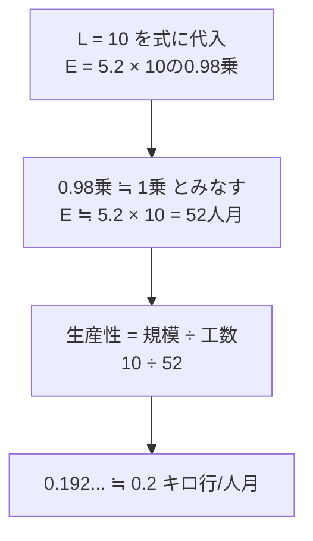

# 開発工数の式と生産性：「べき乗」は怖くない！ほぼ1乗とみなして割るだけ

> **想定読者**: 「5.2×L の 0.98 乗」を見ただけで固まる文系受験者  
> **省いたもの**: 0.98乗の厳密な電卓計算、COCOMO等のモデル詳細  
> **所要時間**: 6〜8分  
> **対象過去問**: 応用情報技術者 平成30年春期 午前問54  

---

## 【対象過去問】平成30年春期 問54

**【問題】**  
あるソフトウェア開発部門では，開発工数E(人月)と開発規模L(キロ行)との関係を，E＝5.2L^0.98（Lの0.98乗）としている。L＝10としたときの生産性(キロ行／人月)は，およそ幾らか。

- **ア**: 0.2
- **イ**: 0.5
- **ウ**: 1.9
- **エ**: 5.2

▶ 正解を表示する

**正解: ア（0.2）**

---

## 0. 一枚で：『生産性＝規模÷工数。0.98乗は“ほぼ1乗”で近似！』

### 🧠 脳に刻む合言葉：
> **『 生産性＝できた量÷かかった工数！ほぼ1乗なら 5.2×10＝52 』**

---

## 1. なぜそうなるのか？（日常のたとえ話：1人が1か月に書ける原稿の量）

「ライターが1か月（＝1人月）で何ページ書けるか」が生産性です。10キロ行（＝1万行）のプログラムを書くのに52人月かかったなら、1人月あたりは 10÷52 ≒ 0.19キロ行（約190行）。意外と少なく感じますが、設計・テスト・会議を含めた“全工程込み”の工数だからです。

### 途中計算（省略なし）
1. 生産性 ＝ 開発規模 ÷ 開発工数
2. E ＝ 5.2 × 10^0.98。10^0.98 は 10^1＝10 にとても近いので、公式解説どおり「約1乗」とみなして E ≒ 5.2 × 10 ＝ **52人月**
3. 生産性 ＝ 10 ÷ 52 ＝ 0.192… ≒ **0.2キロ行/人月**

（参考：10^0.98 を厳密に計算しても約9.55で、E ≒ 49.7、生産性 ≒ 0.20 となり、答えは変わりません。）

---

## 2. 選択肢のひっかけポイント ＆ 判定理由

- **ア（0.2）: ○**  
  → 10÷52 ＝ 0.192… ≒ 0.2。公式解説と一致。
- **イ（0.5）: ✗**  
  → 工数を5.2×L＝52でなく約20程度と誤る、など計算経路が合わない値。10÷52 は0.5にならない。
- **ウ（1.9）: ✗**  
  → 10÷52＝0.192 の**小数点の位置を1桁ずらした**値（0.192 → 1.92）。小数点ミスの罠。
- **エ（5.2）: ✗**  
  → 式の係数5.2を、そのまま答えにしてしまう罠。5.2は係数であり、生産性ではない。

> ⚠️ 逆数の罠にも注意。「工数÷規模」＝52÷10＝5.2 は“1キロ行あたりの人月”であり、生産性（キロ行/人月）とは**逆**。単位「キロ行／人月」＝「キロ行 ÷ 人月」と読めば間違えません。

---

## 3. 午後試験 記述対策チェックリスト（※該当する場合）

- [ ] **Q. 生産性の求め方を述べよ。**  
  → **「生産性＝開発規模（キロ行）÷開発工数（人月）で求める。」**

---

## 🎯 次の2分アクション（定着チェック）

- [ ] **画面の一番上に戻り、正解を隠した状態で正解肢を確信を持って選べるか試してみよう！**
