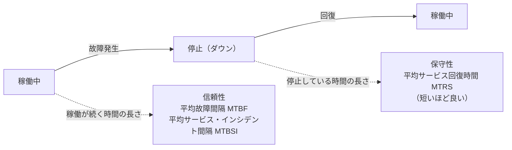

# 可用性管理の保守性指標：「入院から退院までの日数」で覚える「平均サービス回復時間（MTRS）」

> **想定読者**: 信頼性・保守性・可用性の指標がごちゃ混ぜになる文系受験者  
> **省いたもの**: ITILの可用性管理プロセスの詳細な活動内容  
> **所要時間**: 6〜8分  
> **対象過去問**: 応用情報技術者 令和4年春期 午前問56  

---

## 【対象過去問】令和4年春期 問56

**【問題】**  
ITIL 2011 editionでは，可用性管理における重要業績評価指標(KPI)の例として，"保守性を表す指標値"の短縮を挙げている。保守性を表す指標に該当するものはどれか。

- **ア**: 一定期間内での中断の数
- **イ**: 平均故障間隔
- **ウ**: 平均サービス・インシデント間隔
- **エ**: 平均サービス回復時間

▶ 正解を表示する

**正解: エ（平均サービス回復時間）**

---

## 0. 一枚で：「壊れてから直るまで」＝保守性！

### 🧠 脳に刻む合言葉：
> **『 保守性＝直す速さ（回復時間）、信頼性＝壊れにくさ（間隔）！ 』**

---

## 1. なぜそうなるのか？（日常のたとえ話：スマホの入院）

- **信頼性**: スマホが「どれだけ壊れずに使えるか」。壊れる間隔が長いほど良い。
- **保守性**: 壊れたとき「どれだけ早く修理から戻ってくるか」。**ダウン時間が短いほど**保守性が高い。
- **可用性**: 「必要なときに使える状態にある割合・状況」。

公式解説のとおり、保守性とは、ITサービスその他の構成アイテムを**どの程度迅速かつ効果的に通常の稼働状態に戻せるか**を表す指標です。簡単に言えば**ダウンタイムの短さ**です。ITサービスマネジメントでは、システムが停止してからユーザーが再び利用できるようになるまでの平均時間「**平均サービス回復時間（MTRS）**」が保守性の指標として使われます。

---

## 2. 選択肢のひっかけポイント ＆ 判定理由

- **ア: 一定期間内での中断の数 → ×**  
  公式解説では**可用性**を表す指標。中断が何回あったかであって、回復の速さではありません。
- **イ: 平均故障間隔 → ×**  
  公式解説では**信頼性**を表す指標（MTBF）。「壊れるまでの長さ」で、直す速さではありません。
- **ウ: 平均サービス・インシデント間隔 → ×**  
  公式解説では**信頼性**を表す指標（MTBSI）。サービスのインシデントが起きる間隔であり、これも「壊れにくさ」側です。
- **エ: 平均サービス回復時間 → ○**  
  停止から利用可能になるまでの平均時間（MTRS）。保守性を測る指標です。

> 💡 **ひっかけ**: 「間隔（長いほど良い）＝信頼性」と「時間（短いほど良い）＝保守性」。**良くなる方向が逆**である点が問題文の「短縮」にも表れています。「短縮を目標にできるのは回復時間」と気づければ即決です。

---

## 3. 午後試験 記述対策チェックリスト（※該当する場合）

- [ ] **Q. 保守性を測る指標と、その意味を述べよ。**  
  → **「平均サービス回復時間（MTRS）。停止から利用可能に戻るまでの平均時間で、短いほど保守性が高い。」**

---

## 🎯 次の2分アクション（定着チェック）

- [ ] **画面の一番上に戻り、正解を隠した状態で正解肢を確信を持って選べるか試してみよう！**
- [ ] 「可用性＝中断の数、信頼性＝間隔、保守性＝回復時間」と言ってみる。
