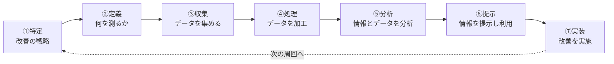

# ITILの7ステップの改善プロセス：「家計簿の見直し」で覚える「収集→処理→分析→提示」

> **想定読者**: ITILの横文字プロセスが頭に残らない文系受験者  
> **省いたもの**: 各ステップの入出力や成果物の細則  
> **所要時間**: 6〜8分  
> **対象過去問**: 応用情報技術者 令和元年秋期 午前問56  

---

## 【対象過去問】令和元年秋期 問56

**【問題】**  
ITIL 2011 editionによれば，7ステップの改善プロセスにおけるa，b及びcの適切な組合せはどれか。  
〔7ステップの改善プロセス〕

> ⚠️ **復元に関する注記**: 原問題では7ステップの図が提示され、ステップ4〜6にあたる空欄a, b, cを、下の選択肢の組合せから選びます。取得データには図と選択肢ア〜エの各組合せ本文が含まれていません（選択肢欄は「イ ウ エ」とのみ記録）。そのため、ここでは公式解説から「空欄に入る正しい内容」だけを復元しています。

- **空欄a（ステップ4）**: 公式解説により「データを処理する」と対応
- **空欄b（ステップ5）**: 同じく「情報とデータを分析する」と対応
- **空欄c（ステップ6）**: 同じく「情報を提示して利用する」と対応
- **ア〜エの選択肢**: 取得データに本文なし（復元不可）

▶ 正解を表示する

**正解: ウ**  
（a＝データを処理する、b＝情報とデータを分析する、c＝情報を提示して利用する、の組合せ）

---

## 0. 一枚で：「特定→定義→収集→処理→分析→提示→実装」の順番を言える！

### 🧠 脳に刻む合言葉：
> **『 集めて、処理して、分析して、見せる！ 』**（③収集 → ④処理 → ⑤分析 → ⑥提示）

---

## 1. なぜそうなるのか？（日常のたとえ話：家計簿で食費を減らす）

「食費を減らしたい」と思ったら、次の順で動きます。

1. **特定**: 「食費を見直そう」と方針を決める
2. **定義**: 何を測るか決める（月の食費、外食回数）
3. **収集**: レシートを集める
4. **処理**: レシートを表に入力して整理する（＝データを処理する）
5. **分析**: 「外食が増えた月は赤字」と傾向を読み解く（＝情報とデータを分析する）
6. **提示**: 家族に結果を見せて共有する（＝情報を提示して利用する）
7. **実装**: 実際に自炊を増やして改善する

公式解説のとおり、7ステップの改善プロセスとは、改善を **①特定、②定義、③収集、④処理、⑤分析、⑥提示、⑦実装** するために必要な手順を定義・管理するプロセスです。**データは「集めただけ」では役に立たず、加工（処理）→読み解き（分析）→見せる（提示）を経て、初めて改善行動（実装）につながります。**

---

## 2. 選択肢のひっかけポイント ＆ 判定理由

取得データには選択肢ア〜エの本文がないため、**各選択肢ごとの判定理由は復元できません**。公式解説から確実に言える範囲は次のとおりです。

- **ウ → ○（正解）**  
  ④処理＝データを処理する、⑤分析＝情報とデータを分析する、⑥提示＝情報を提示して利用する、と順番どおりに対応しているため。
- **ア・イ・エ → ×**  
  公式解説にこれらの内容記載はなく、正解の対応関係と食い違う組合せです（具体的な誤り方は復元不可）。

> 💡 **ひっかけの一般的な型（推定）**: 「分析」と「処理」の入れ替え、「提示」と「実装」の混同。**収集した後に処理、その後に分析、最後に提示**の順序を固定して覚えれば、並び替え型の選択肢を消せます。

---

## 3. 午後試験 記述対策チェックリスト（※該当する場合）

- [ ] **Q. 7ステップの改善プロセスで、データ収集の後に行うことは何か。**  
  → **「収集したデータを処理し、情報とデータを分析した後、結果を提示して利用し、改善を実装する。」**

---

## 🎯 次の2分アクション（定着チェック）

- [ ] **画面の一番上に戻り、正解を隠した状態で正解肢を確信を持って選べるか試してみよう！**
- [ ] 7ステップを「特定・定義・収集・処理・分析・提示・実装」と声に出して言う。
