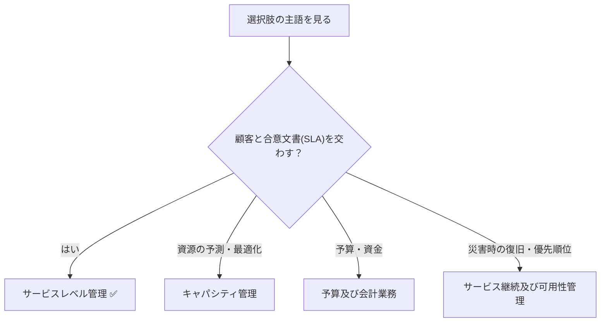

# サービスレベル管理プロセス：お客さんと「ここまで保証します」と契約書を交わす係

> **想定読者**: ITILのプロセス名（キャパシティ管理・継続管理など）が似ていて区別できない文系受験者  
> **省いたもの**: 各プロセスの入出力や成果物の詳細  
> **所要時間**: 6〜8分  
> **対象過去問**: 応用情報技術者 令和6年春期 午前問56  

---

## 【対象過去問】令和6年春期 問56

**【問題】**  
サービスマネジメントにおけるサービスレベル管理プロセスの活動はどれか。

- **ア**: 現在の資源の調整と最適化とを行い，将来の資源要件に関する予測を記載した計画を作成する。
- **イ**: サービスの提供に必要な予算に応じて，適切な資金を確保する。
- **ウ**: 災害や障害などで事業が中断しても，要求されたサービス機能を合意された期間内に確実に復旧できるように，事業影響度の評価や復旧優先順位を明確にする。
- **エ**: 提供するサービス及びサービスレベル目標を決定し，サービス提供者が顧客との間で合意文書を交わす。

▶ 正解を表示する

**正解: エ（提供するサービス及びサービスレベル目標を決定し，サービス提供者が顧客との間で合意文書を交わす。）**

---

## 0. 一枚で：『サービスレベル管理＝顧客との約束（SLA）を決めて守る係！』

### 🧠 脳に刻む合言葉：
> **『 SLA＝顧客との約束書。「合意文書」の文字が見えたらサービスレベル管理！ 』**

---

## 1. なぜそうなるのか？（日常のたとえ話：宅配ピザ店の「30分以内にお届け」保証）

ピザ店が「30分以内にお届けします。遅れたら割引」と客に約束するとします。これがSLA（サービスレベルアグリーメント）です。約束の内容（サービスとレベル目標）を決め、客と合意し、実際に守れているか毎月確認し、守れなければ改善する。この一連の係がサービスレベル管理です。

公式解説では、サービスレベル管理は「SLAに基づいて顧客要件を満たすサービスの提供を実現するとともに、サービス品質の継続的な改善を図るための管理活動」で、サービスレベル目標や例外を定めて顧客と提供者でSLAを合意することも活動の一つです。維持・管理のために「モニタリング」「レポーティング」「レビュー」「改善」というPDCAサイクルを繰り返します。

---

## 2. 選択肢のひっかけポイント ＆ 判定理由

- **ア: ✗（キャパシティ管理の活動）**  
  → 「資源の調整と最適化」「将来の資源要件の予測」＝ピザ店で言えば「ピザ窯や配達員を何人揃えるか」の計画。約束ではなく、約束を守るための設備計画。
- **イ: ✗（サービスの予算及び会計業務の活動）**  
  → 「予算」「資金」というお金のキーワード。店の経理係の仕事。
- **ウ: ✗（サービス継続及び可用性管理の活動）**  
  → 「災害・障害で中断」「復旧」「事業影響度」「復旧優先順位」＝店が火事になっても営業再開できる備え（BCP的）。
- **エ: ○（サービスレベル管理の活動）**  
  → 「サービスレベル目標を決定」「顧客と合意文書」＝SLAの締結そのもの。

> ⚠️ ウは「合意された期間内に」と“合意”の語が入っているのがひっかけ。しかし主題は**復旧の備え**であり、合意文書を交わす活動ではない。

---

## 3. 午後試験 記述対策チェックリスト（※該当する場合）

- [ ] **Q. サービスレベル管理で繰り返すPDCAの活動を挙げよ。**  
  → **「モニタリング、レポーティング、レビュー、改善を繰り返す。」**

---

## 🎯 次の2分アクション（定着チェック）

- [ ] **画面の一番上に戻り、正解を隠した状態で正解肢を確信を持って選べるか試してみよう！**
