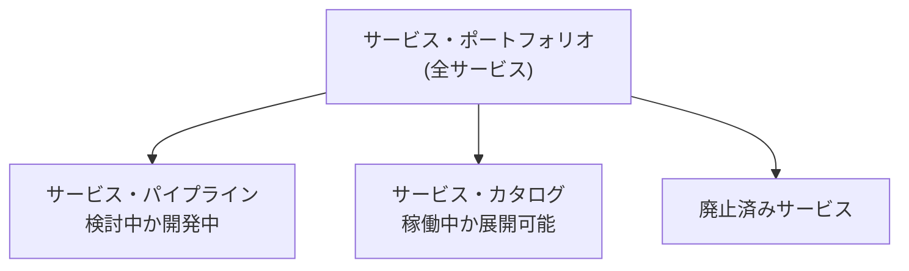

# タイトル：【レストランの全メニュー台帳】で覚える「サービス・ポートフォリオ」

> **想定読者**: サービス・ポートフォリオ／パイプライン／カタログの違いが曖昧な文系受験者  
> **省いたもの**: ITIL 2011 のライフサイクル各段階の詳細プロセス  
> **所要時間**: 6〜8分  
> **対象過去問**: 応用情報技術者 [令和3年春期 午前問56](https://www.ap-siken.com/kakomon/03_haru/q56.html)  

---

## 【対象過去問】令和3年春期 午前問56

**【問題】**  
ITIL 2011 editionによれば，サービス・ポートフォリオの説明のうち，適切なものはどれか。

- **ア**: サービス・プロバイダの約束事項と投資を表すものであって，サービス・プロバイダによって管理されている"検討中か開発中"，"稼働中か展開可能"及び"廃止済み"の全てのサービスが含まれる。
- **イ**: サービスの販売と提供の支援に使用され，顧客に公開されるものであって，"検討中か開発中"と"廃止済み"のサービスは含まれず，"稼働中か展開可能"のサービスだけが含まれる。
- **ウ**: 投資の機会と実現される価値を含むものであって，"廃止済み"のサービスは含まれず，"検討中か開発中"のサービスと"稼働中か展開可能"のサービスが含まれる。
- **エ**: どのようなサービスが提供できたのか，実力を示すものであって，"検討中か開発中"のサービスは含まれず，"稼働中か展開可能"のサービスと"廃止済み"のサービスが含まれる。

▶ 正解を表示する

**正解: ア（全てのサービスを含む）**

---

## 0. 一枚で：「ポートフォリオ＝3つの箱の全部入り」！

**合言葉：『ポートフォリオは“全部”、カタログは“今売ってる分だけ”』**

---

## 1. なぜそうなるのか？（日常のたとえ話）

レストランの **経営者用の全メニュー台帳** を想像してください。台帳には

- 「来月から出す新メニューの試作中リスト」（パイプライン＝検討中か開発中）
- 「今お客さんに出せるメニュー」（カタログ＝稼働中か展開可能）
- 「もう販売をやめた過去のメニュー」（廃止済み）

が **全部まとめて** 載っています。これがサービス・ポートフォリオです。一方、お客さんに渡すメニュー表は「今出せる料理」だけ。これが **サービス・カタログ**。

公式解説：サービス・ポートフォリオはサービス・プロバイダが管理する全サービスをリスト化し、サービスごとに詳細情報をまとめたもの。ライフサイクル上の位置に応じ、上の3つに分けて管理されます。

---

## 2. 選択肢のひっかけポイント ＆ 判定表

| 選択肢 | 判定 | 理由（公式解説） |
|---|---|---|
| ア | ○ | 検討中か開発中・稼働中か展開可能・廃止済みの **全て** を含む。ポートフォリオの説明。 |
| イ | ✕ | 顧客に公開され「稼働中か展開可能」だけを含む → **サービス・カタログ** の説明。 |
| ウ | ✕ | 「廃止済み」を含まないとしている点が誤り。ポートフォリオには廃止済みも含まれる。 |
| エ | ✕ | 「検討中か開発中」を含まないとしている点が誤り。ポートフォリオにはパイプラインも含まれる。 |

**ひっかけ**: ウ・エは「3つの箱のうち1つを抜いた」だけの精巧な偽物。**3つの箱が全て入っているか** を数えて確認すると見破れます。イは「顧客に公開」「販売の支援」という言葉でカタログと見抜く。

---

## 🎯 次の2分アクション（定着チェック）

- [ ] **画面の一番上に戻り、正解を隠した状態で正解肢を確信を持って選べるか試してみよう！**
- [ ] 「パイプライン＝準備中、カタログ＝稼働中、廃止済み＝引退、全部合わせてポートフォリオ」を言えるか確認。
