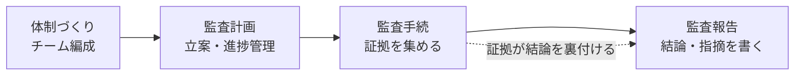

# システム監査の「監査手続」：裁判の証拠集めで覚える「十分かつ適切な監査証拠」

> **想定読者**: 監査計画・監査手続・監査報告の違いがごちゃ混ぜになる文系受験者  
> **省いたもの**: 監査基準の条文や予備調査・本調査の細かな実施要領  
> **所要時間**: 6〜8分  
> **対象過去問**: 応用情報技術者 令和4年秋期 問59  

---

## 【対象過去問】令和4年秋期 問59

**【問題】**  
システム監査における"監査手続"として，最も適切なものはどれか。

- **ア**: 監査計画の立案や監査業務の進捗管理を行うための手順
- **イ**: 監査結果を受けて，監査報告書に監査人の結論や指摘事項を記述する手順
- **ウ**: 監査項目について，十分かつ適切な証拠を入手するための手順
- **エ**: 監査テーマに合わせて，監査チームを編成する手順

▶ 正解を表示する

**正解: ウ（監査項目について，十分かつ適切な証拠を入手するための手順）**

---

## 0. 一枚で：『手続＝証拠を集める作業。計画は前、報告は後！』

### 🧠 脳に刻む合言葉：
> **『 監査手続は“証拠集め”！計画は手続の前、報告書は手続の後！ 』**

3ステップ解法：
1. 選択肢が「監査の流れ」のどこの話かを分類する（体制 / 計画 / 手続 / 報告）。
2. 「手続」＝「監査証拠を入手する」と結びつける。
3. 「証拠」の語が入っている選択肢を選ぶ。

---

## 1. なぜそうなるのか？（日常のたとえ話：裁判の証拠集め）

監査を「裁判」にたとえます。

- 検事（監査人）が「この会社のシステム管理は適切です／不適切です」と**結論**を出すには、**証拠**が必要です。
- 証拠なしの意見は、ただの感想です。
- この**証拠を集める具体的な作業**が「**監査手続**」です。

公式解説によると、監査手続とは、システム監査人が監査意見を裏付けるための**十分かつ適切な監査証拠を入手するために実施する手続**のこと。**予備調査と本調査**に分けて実施されます。

手法には次のようなものがあり、**一般的には複数を組み合わせて**実施します。

| 手法 | 日常のイメージ |
|---|---|
| チェックリスト法 | 健康診断の問診票に○×をつけてもらう |
| ドキュメントレビュー法 | 家計簿やレシートを読み込む |
| インタビュー法 | 本人に「どうしていますか？」と聞く |
| 突合・照合法 | 領収書と帳簿の数字を突き合わせる |
| 現場調査法 | 実際にお店を見に行く |
| コンピュータ支援監査技法 | 電卓やExcelで大量データを一気に検算 |

集めた証拠は、**システム監査報告書に書く監査結論の裏付け**になります。

---

## 2. 選択肢のひっかけポイント ＆ 判定理由

- **ア ✕: 監査計画の立案や進捗管理**  
  → 公式解説では「**監査計画の策定**」に該当。裁判でいえば「どう捜査するか」の段取りで、証拠集めそのものではありません。「手続」と「手順」という言葉の響きが似ているのが罠です。
- **イ ✕: 監査報告書に結論・指摘事項を書く**  
  → 公式解説では「**監査報告書の作成**」に該当。証拠を集めた**後**の、判決文を書く工程です。
- **ウ ◯: 十分かつ適切な証拠を入手する手順**  
  → 公式解説：「監査手続は、監査の結論を裏付けるための監査証拠を入手するプロセス」。これが定義そのものです。
- **エ ✕: 監査テーマに合わせて監査チームを編成する**  
  → 公式解説では「**監査業務の体制構築**」に該当。捜査本部の人選であり、これも準備段階です。

> 💡 作問者の意図：日常語の「手続」から「段取り全般」を連想させ、ア・エを選ばせたい。試験用語の「手続＝証拠を入手するための手順」を確実に覚えているかを問うています。

---

## 3. 午後試験 記述対策チェックリスト（※該当する場合）

- [ ] **Q. システム監査で、監査手続によって入手した監査証拠は何の裏付けになるか。**  
  → **「システム監査報告書に記載する監査人の結論（監査意見）の裏付けとなる。」**

---

## 🎯 次の2分アクション（定着チェック）

- [ ] **画面の一番上に戻り、正解を隠した状態で正解肢を確信を持って選べるか試してみよう！**
