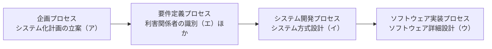

# 共通フレーム2013の要件定義プロセス：「家づくりの聞き取り」で覚える「利害関係者の識別」

> **想定読者**: 企画・要件定義・開発のプロセスの境目があいまいな文系受験者  
> **省いたもの**: 共通フレーム2013の全プロセス一覧の細則  
> **所要時間**: 6〜8分  
> **対象過去問**: 応用情報技術者 令和元年秋期 午前問65  

---

## 【対象過去問】令和元年秋期 問65

**【問題】**  
共通フレーム2013によれば，要件定義プロセスで行うことはどれか。

- **ア**: システム化計画の立案
- **イ**: システム方式設計
- **ウ**: ソフトウェア詳細設計
- **エ**: 利害関係者の識別

▶ 正解を表示する

**正解: エ（利害関係者の識別）**

---

## 0. 一枚で：「企画 → 要件定義 → 開発」の流れの中で位置を決める！

### 🧠 脳に刻む合言葉：
> **『 要件定義はまず「誰が関わるか」を洗い出す！ 』**

---

## 1. なぜそうなるのか？（日常のたとえ話：家を建てる前の聞き取り）

注文住宅を建てる流れで考えます。

1. **企画**: 「家を建てよう」と計画を立てる（システム化計画）
2. **要件定義**: 住む人（家族）や関係者を確認し、「どんな家がほしいか」を聞き取って決める
3. **方式設計**: 構造・工法を決める
4. **詳細設計・実装**: 部屋ごとの細部を設計して建てる

共通フレーム2013の要件定義プロセスは、**利用者や他の利害関係者が求めるシステムへの要件を定義する**プロセスです。システムにかかわる利害関係者を識別し、そのニーズや要望を抽出します。公式解説では実施アクティビティを次の5つとしています。

| 順 | アクティビティ |
| :-: | :-- |
| 1 | 利害関係者の識別 |
| 2 | 要件の識別 |
| 3 | 要件の評価 |
| 4 | 要件の合意 |
| 5 | 要件の記録 |

---

## 2. 選択肢のひっかけポイント ＆ 判定理由

- **ア: システム化計画の立案 → ×**  
  **企画プロセス**で行います。要件定義より前の段階です。
- **イ: システム方式設計 → ×**  
  **システム開発プロセス**で行います。要件が決まった後に、どう作るかを決める工程です。
- **ウ: ソフトウェア詳細設計 → ×**  
  **ソフトウェア実装プロセス**で行います。さらに後工程の細かい設計です。
- **エ: 利害関係者の識別 → ○**  
  要件定義プロセスの最初のアクティビティです。

> 💡 **ひっかけ**: 「要件定義」と聞いて「計画」「設計」の語が並ぶ選択肢に引っ張られがち。**「何を作るか（要件）」は、「なぜ・いつ（企画）」の後、「どう作るか（設計）」の前**と位置づけましょう。

---

## 3. 午後試験 記述対策チェックリスト（※該当する場合）

- [ ] **Q. 要件定義プロセスで最初に行うことは何か。**  
  → **「システムに関わる利害関係者を識別し、そのニーズや要望を抽出する。」**

---

## 🎯 次の2分アクション（定着チェック）

- [ ] **画面の一番上に戻り、正解を隠した状態で正解肢を確信を持って選べるか試してみよう！**
- [ ] 要件定義の5アクティビティ（利害関係者の識別・要件の識別・評価・合意・記録）を言ってみる。
