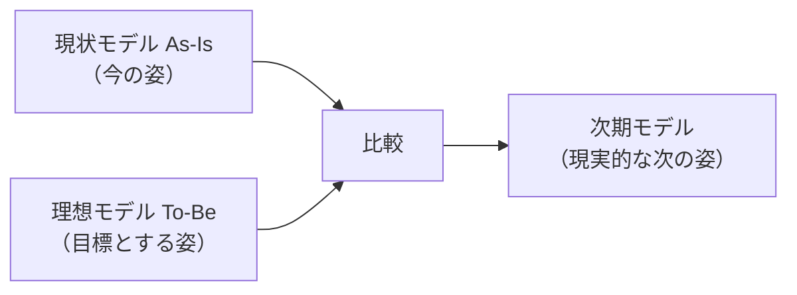

# EAのTo-Beモデル：旅行の「目的地マップ」で覚える「理想の将来像」

> **想定読者**: As-Is／To-Be、EA参照モデル、ザックマンモデルが混ざる文系受験者  
> **省いたもの**: 4つの体系ごとの詳細な成果物  
> **所要時間**: 5〜6分  
> **対象過去問**: 応用情報技術者 平成29年秋期 午前問61

---

## 【対象過去問】平成29年秋期 問61

**【問題】**  
エンタープライズアーキテクチャにおいて，業務と情報システムの理想を表すモデルはどれか。

- **ア**: EA参照モデル
- **イ**: To-Beモデル
- **ウ**: ザックマンモデル
- **エ**: データモデル

▶ 正解を表示する

**正解: イ（To-Beモデル）**

---

## 0. 一枚で：『As-Is＝今ここ、To-Be＝行きたい未来！』

### 🧠 脳に刻む合言葉：
> **『 理想の To-Be、現状の As-Is 』**

---

## 1. なぜそうなるのか？（日常のたとえ話：ダイエット計画）

ダイエットで、「今の体重・体型」を測り(As-Is)、「3か月後の理想の体型」を決め(To-Be)、両者の差を見て「週何回運動するか」という現実的な計画を立てますよね。

EA（エンタープライズアーキテクチャ）も同じです。公式解説によると、EAでは **「政策・業務体系」「データ体系」「適用処理体系」「技術体系」の4つの体系** それぞれで、

1. 最初に現状を分析した **現状モデル(As-Is)** を整理
2. 目標とする **理想モデル(To-Be)** を描く
3. 最後に現状と理想目標を比較した、現実的な **次期モデル** を作成

という順に進めます。To-Beは「To be＝あるべき姿」と読めば覚えやすいです。

---

## 2. 選択肢のひっかけポイント ＆ 判定理由

| 選択肢 | 判定 | 理由（公式解説に基づく） |
|---|---|---|
| **ア** EA参照モデル | ✕ | 政府が公開しているEAのひな型のこと。理想の姿そのものではない。 |
| **イ** To-Beモデル | ◯ | 対象の理想的な将来像・目標を表現するモデル。 |
| **ウ** ザックマンモデル | ✕ | 1987年ジョン・A・ザックマンが提唱した、EAの基礎となっているフレームワーク。5種類の異なる立場の視点と、それぞれの5W1H（What、How、Where、Who、When、Why）の側面から分析・記述する手法。 |
| **エ** データモデル | ✕ | 対象業務を、情報システムやDBMSにおける抽象的な形式としてモデル化したもの。EA固有の「理想」の意味はない。 |

- **ひっかけ心理**: 「参照モデル」「ザックマンモデル」はEAの有名語なので、「EA＝正解」と錯覚しやすい。**問われているのは「理想」＝将来像** なので、キーワードは To-Be。
- 「データモデル」は名前が似ているだけで、EAの4体系の一つ「データ体系」とも別物。選択肢のモデルの種類が違う点に注意。

---

## 3. 午後試験 記述対策チェックリスト（※該当する場合）

- [ ] **Q. EAにおけるTo-Beモデルとは何か。**  
  → **「対象の理想的な将来像・目標を表現するモデルで、現状(As-Is)との比較から次期モデルを作る基になる。」**

---

## 🎯 次の2分アクション（定着チェック）

- [ ] **画面の一番上に戻り、正解を隠した状態で正解肢「イ」を確信を持って選べるか試してみよう！**
