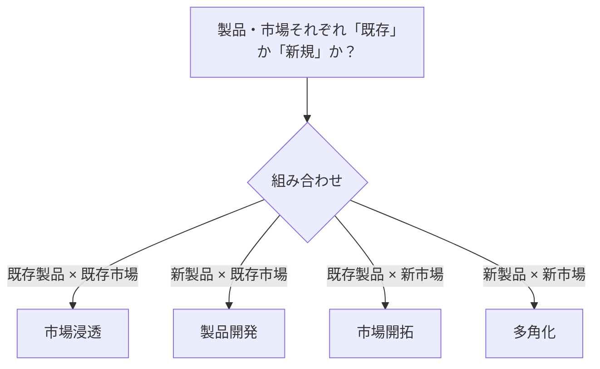

# アンゾフの成長マトリクス：パン屋の「4つの攻め方」で覚える「市場×製品」

> **想定読者**: SWOT・PPM・プロダクトライフサイクルとアンゾフが混ざる文系受験者  
> **省いたもの**: 各象限のリスク度合いの学説的議論  
> **所要時間**: 5〜6分  
> **対象過去問**: 応用情報技術者 平成28年秋期 午前問68

---

## 【対象過去問】平成28年秋期 問68

**【問題】**  
アンゾフが提唱する成長マトリクスを説明したものはどれか。

- **ア**: 自社の強みと弱み，市場における機会と脅威を，分類ごとに列挙して，事業戦略における企業の環境分析を行う。
- **イ**: 製品と市場の視点から，事業拡大の方向性を市場浸透・製品開発・市場開拓・多角化に分けて，戦略を検討する。
- **ウ**: 製品の市場占有率と市場成長率から，企業がそれぞれの事業に対する経営資源の最適配分を意思決定する。
- **エ**: 製品の導入期・成長期・成熟期・衰退期の各段階に応じて，製品の改良，新品種の追加，製品廃棄などを計画する。

▶ 正解を表示する

**正解: イ（製品と市場の視点から，市場浸透・製品開発・市場開拓・多角化に分けて戦略を検討する）**

---

## 0. 一枚で：『アンゾフ＝製品×市場の2×2、既存か新規か！』

### 🧠 脳に刻む合言葉：
> **『 アンゾフは4つの攻め方：浸透・開発・開拓・多角化 』**

---

## 1. なぜそうなるのか？（日常のたとえ話：駅前のパン屋の作戦会議）

パン屋が「もっと成長したい」とき、作戦は4つに整理できます。

| | 既存の製品 | 新規の製品 |
|---|---|---|
| **既存の市場（今のお客さん）** | 市場浸透：今のパンをもっと買ってもらう | 製品開発：今のお客さんに新作パンを出す |
| **新規の市場（新しいお客さん）** | 市場開拓：今のパンを隣町でも売る | 多角化：新しい商品を新しい客層へ（例：カフェ事業） |

公式解説では、アンゾフ（H・イゴール・アンゾフ）が提唱したもので、縦軸に「市場」、横軸に「製品」をとり、それぞれ「既存」「新規」の2区分を設けた4象限のマトリクスとされています。**事業が成長・発展できる経営戦略を検討するためのフレームワーク** です。

---

## 2. 選択肢のひっかけポイント ＆ 判定理由

| 選択肢 | 判定 | 理由（公式解説に基づく） |
|---|---|---|
| **ア** 強み・弱み・機会・脅威を列挙して環境分析 | ✕ | **SWOT分析** の説明。内部（強み・弱み）と外部（機会・脅威）の4要素。 |
| **イ** 市場浸透・製品開発・市場開拓・多角化 | ◯ | **アンゾフの成長マトリクス** の説明。 |
| **ウ** 市場占有率と市場成長率から経営資源を配分 | ✕ | **プロダクトポートフォリオマネジメント（PPM）** の説明。 |
| **エ** 導入期・成長期・成熟期・衰退期に応じた計画 | ✕ | **プロダクトライフサイクル** の説明。 |

- **ひっかけ心理**: どれも「2軸のマトリクスや段階で戦略を考える」フレームワークで似て見える。**4つの名前（浸透・開発・開拓・多角化）が出ればアンゾフ** と決め打ちできる。
- 見分けキーワード：強み/弱み → SWOT、占有率/成長率 → PPM、導入〜衰退 → PLC。

---

## 3. 午後試験 記述対策チェックリスト（※該当する場合）

- [ ] **Q. アンゾフの成長マトリクスの4象限を挙げよ。**  
  → **「市場浸透、製品開発、市場開拓、多角化（製品と市場を既存・新規に分けた4区分）。」**

---

## 🎯 次の2分アクション（定着チェック）

- [ ] **画面の一番上に戻り、正解を隠した状態で正解肢「イ」を確信を持って選べるか試してみよう！**
