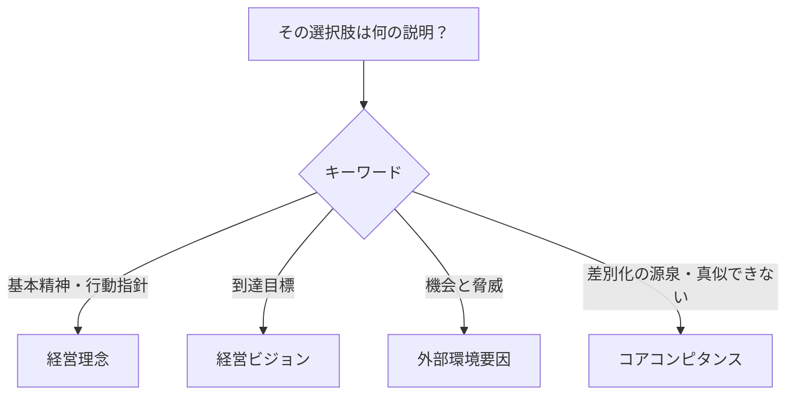

# コアコンピタンス：老舗うなぎ屋の「秘伝のタレ」で覚える「差別化の源泉」

> **想定読者**: 経営理念・ビジョン・SWOTの「機会と脅威」とコアコンピタンスが混ざる文系受験者  
> **省いたもの**: 経営学者による定義の変遷  
> **所要時間**: 5〜6分  
> **対象過去問**: 応用情報技術者 平成23年特別 午前問66

---

## 【対象過去問】平成23年特別 問66

**【問題】**  
コアコンピタンスを説明したものはどれか。

- **ア**: 経営活動における基本精神や行動指針
- **イ**: 事業戦略の遂行によって達成すべき到達目標
- **ウ**: 自社を取り巻く環境に関するビジネス上の機会と脅威
- **エ**: 他社との差別化の源泉となる経営資源

▶ 正解を表示する

**正解: エ（他社との差別化の源泉となる経営資源）**

---

## 0. 一枚で：『コア（核）＋コンピタンス（能力）＝他社が真似できない核の力！』

### 🧠 脳に刻む合言葉：
> **『 コアコンピタンス＝真似できない自社の核の力 』**

---

## 1. なぜそうなるのか？（日常のたとえ話：老舗うなぎ屋の秘伝のタレ）

創業100年のうなぎ屋があります。立地や店構えは真似できても、**代々継ぎ足してきた秘伝のタレと焼きの技** だけは他店が簡単に真似できません。そのため客は遠くからでも来てくれます。この「真似できない独自の力」がコアコンピタンスです。

公式解説では、**長年の企業活動により蓄積され、他社には模倣できない企業独自の能力（プロセス、ノウハウ、技術、企業文化など）** で、単なる強みを超え、競争優位を生み出す源泉とされています。共通性質は次の3つです。

1. 様々な市場に展開可能
2. 競合他社による模倣が困難
3. 顧客価値の向上に大きく寄与する

例：ホンダのエンジン技術、ソニーの小型化技術、トヨタ自動車の生産プロセス。

---

## 2. 選択肢のひっかけポイント ＆ 判定理由

| 選択肢 | 判定 | 理由（公式解説に基づく） |
|---|---|---|
| **ア** 基本精神や行動指針 | ✕ | **経営理念** の説明。うなぎ屋なら「まごころを込めて焼く」という店訓。 |
| **イ** 到達すべき目標 | ✕ | **経営ビジョン** の説明。「5年後に全国展開」のような目指す姿。 |
| **ウ** 機会と脅威 | ✕ | **外部環境要因** の説明（SWOTの O と T）。自社の能力ではなく、周りの状況。 |
| **エ** 差別化の源泉となる経営資源 | ◯ | **コアコンピタンス** の説明。 |

- **ひっかけ心理**: ア・イは「経営の根っこ」っぽく見え、ウは「分析っぽい」ので紛らわしい。**「資源・能力」の話か、「理念・目標・環境」の話か** で分ける。
- 「他社との差別化」「模倣困難」が出たら即コアコンピタンス。

---

## 3. 午後試験 記述対策チェックリスト（※該当する場合）

- [ ] **Q. コアコンピタンスの特徴を挙げよ。**  
  → **「様々な市場に展開でき、他社が模倣しにくく、顧客価値の向上に大きく寄与する独自の能力。」**

---

## 🎯 次の2分アクション（定着チェック）

- [ ] **画面の一番上に戻り、正解を隠した状態で正解肢「エ」を確信を持って選べるか試してみよう！**
