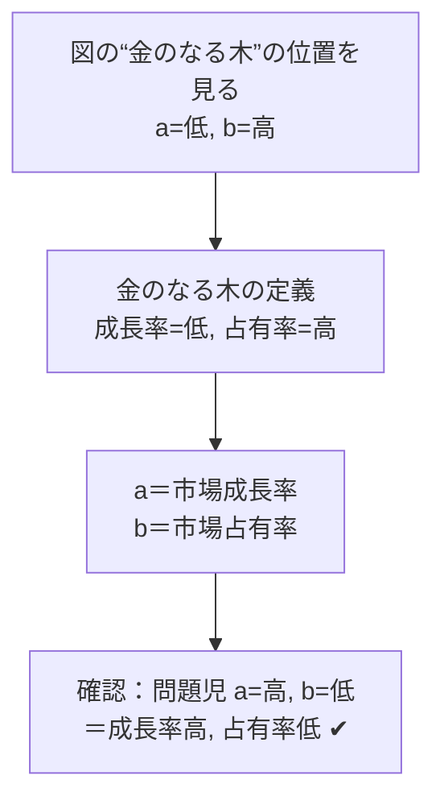

# PPMマトリックス：果樹園で覚える「縦軸は成長率・横軸は占有率」

> **想定読者**: 花形・金のなる木・問題児・負け犬の位置と軸があいまいな文系受験者  
> **省いたもの**: PPMの批判や発展モデル、投資額の数値計算  
> **所要時間**: 6〜8分  
> **対象過去問**: 応用情報技術者 令和3年春期 問67  

---

## 【対象過去問】令和3年春期 問67

**【問題】**  
プロダクトポートフォリオマネジメント(PPM)マトリックスのa，bに入れる語句の適切な組合せはどれか。

> ⚠️ **復元に関する注意**: 原問題は図表問題で、マトリックス図と選択肢の表（a, b の語句の組合せ）は画像のため取得できませんでした。取得データの選択肢は「イ ウ エ」としか残っておらず、各選択肢の具体的な語句は復元できません。以下は公式解説の記述から言える範囲のみを書いています。

- 図：4象限のマトリックス（"金のなる木"の位置が a=低，b=高、"問題児"の位置が a=高，b=低 となっている ※公式解説の記述より）
- **ア〜エ**: a, b に入れる語句の組合せ（各選択肢の具体的内容は復元不可）

▶ 正解を表示する

**正解: ウ（a＝市場成長率，b＝市場占有率）**  
※「ウ」の選択肢の具体的な語句は原データにないため、公式解説の結論（aが市場成長率、bが市場占有率）から記載。

---

## 0. 一枚で：『“金のなる木”は成長率が低く占有率が高い、を座標に当てはめる！』

| 象限 | 市場成長率 | 市場占有率 |
|---|---|---|
| 花形（star） | 高 | 高 |
| 金のなる木（cash cow） | 低 | 高 |
| 問題児（problem child） | 高 | 低 |
| 負け犬（dog） | 低 | 低 |

### 🧠 脳に刻む合言葉：
> **『 金のなる木は“成長低・占有高”、問題児は“成長高・占有低”！ 』**

---

## 1. なぜそうなるのか？（日常のたとえ話：果樹園の経営）

- **花形**：すくすく育つ若木で、実もたくさんなる。ただし水や肥料（投資）をたっぷり与え続けないと、シェアを守れない。
- **金のなる木**：もう大木で成長は止まった。だから肥料はほぼ不要なのに、実（利益）だけは安定して取れる。→ 追加投資が必須でなく、安定した資金・利益が見込める。
- **問題児**：芽はぐんぐん伸びている（成長率高）が、まだ実が少ない（占有率低）。花形に育てるには多額の投資が必要。失敗してそのまま成長率が下がれば負け犬に…。慎重な対応が必要。
- **負け犬**：伸びもしないし実もならない。投資しても利益が見込めず、撤退を検討。

公式解説：PPMは縦軸・横軸に**市場成長率**と**市場占有率**を設定したマトリクスを4象限に分け、製品の位置付けを分析して**経営資源の最適な配分**を検討する手法です。

### 軸を特定する手順
1. 図中の“金のなる木”の位置は「a＝低、b＝高」。
2. 金のなる木は【成長率：低、占有率：高】なので、a＝成長率、b＝占有率。
3. “問題児”の位置「a＝高、b＝低」とも、【成長率：高、占有率：低】で矛盾なし。

したがって「aが市場成長率、bが市場占有率」の組合せが正しく、それが選択肢「ウ」です。

---

## 2. 選択肢のひっかけポイント ＆ 判定理由

各選択肢の具体的な語句は取得できないため、公式解説から言える判定の根拠を示します。

- **ア・イ・エ ✕（ウ以外）**  
  → 公式解説は「aが市場成長率、bが市場占有率である組合せがウ」と結論しています。したがってア・イ・エは、この組合せ（a＝成長率, b＝占有率）と異なるもの、つまり a と b を逆にしたもの、または別の語句の組合せです。※具体的な語句は復元不可。
- **ウ ◯**  
  → a＝市場成長率、b＝市場占有率。金のなる木（a=低, b=高）、問題児（a=高, b=低）の両方と整合します。

> 💡 ひっかけ：**軸の順番**。「占有率が横軸」と覚えこむより、図の“金のなる木”と“問題児”の位置から**毎回その場で軸を決める**ほうが確実です。図のどの象限がどの名前かさえ分かれば、軸の取り違えは起きません。

---

## 3. 午後試験 記述対策チェックリスト（※該当する場合）

- [ ] **Q. PPMで“負け犬”に分類された事業は、どのように扱うべきか。**  
  → **「成長率・占有率ともに低く、投資しても利益増が見込めないため、市場からの撤退を検討する。」**

---

## 🎯 次の2分アクション（定着チェック）

- [ ] **画面の一番上に戻り、正解を隠した状態で正解肢を確信を持って選べるか試してみよう！**
