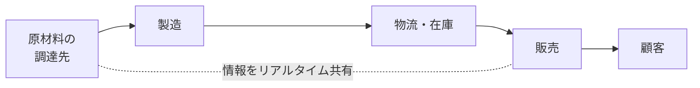

# SCMの目的：バケツリレーで覚える「企業をまたぐ一気通貫の情報共有」

> **想定読者**: SCM・CRM・SFA・ERPの略語が似ていて区別できない文系受験者  
> **省いたもの**: SCMシステムの詳細な導入手順・需要予測モデル  
> **所要時間**: 6〜8分  
> **対象過去問**: 応用情報技術者 平成29年春期 問67  

---

## 【対象過去問】平成29年春期 問67

**【問題】**  
SCMの目的はどれか。

- **ア**: 顧客情報や購買履歴，クレームなどを一元管理し，きめ細かな顧客対応を行うことによって，良好な顧客関係の構築を目的とする。
- **イ**: 顧客情報や商談スケジュール，進捗状況などの商談状況を一元管理することによって，営業活動の効率向上を目的とする。
- **ウ**: 生産，販売，在庫管理，財務会計，人事管理など基幹業務のあらゆる情報を統合管理することによって，経営効率の向上を目的とする。
- **エ**: 複数の企業や組織にまたがる調達から販売までの業務プロセス全ての情報を統合的に管理することによって，コスト低減や納期短縮などを目的とする。

▶ 正解を表示する

**正解: エ（複数の企業や組織にまたがる調達から販売までの業務プロセス全ての情報を統合的に管理することによって，コスト低減や納期短縮などを目的とする。）**

---

## 0. 一枚で：『SCM＝“サプライチェーン”＝つなぐ相手は“他社も含めた流れ”！』

| 略語 | 管理する対象 | 一言 |
|---|---|---|
| **SCM** | 調達〜販売の流れ全体（企業間） | 供給の鎖 |
| **CRM** | 顧客との関係 | お客様カルテ |
| **SFA** | 営業活動・商談 | 営業の進捗ボード |
| **ERP** | 社内の基幹業務 | 社内の全部入り台帳 |

### 🧠 脳に刻む合言葉：
> **『 SCMは“鎖”（Chain）！調達から販売まで会社をまたいでつなげ、納期短縮・在庫削減！ 』**

---

## 1. なぜそうなるのか？（日常のたとえ話：バケツリレー）

火事場のバケツリレーを想像してください。水をくむ人（調達）→運ぶ人（製造・物流）→かける人（販売）が一列に並びます。

- 誰かが「今、水が足りない」「こっちはもう空っぽ」と**情報を共有せず**に動くと、途中で水があふれたり（在庫過多）、先頭で足りなくなったり（欠品）して非効率です。
- 全員が**リアルタイムに状況を共有**すれば、無駄な待ちがなくなり、バケツは最短で届きます。

これがSCM（Supply Chain Management）です。公式解説では、生産・在庫・購買・販売・物流などの情報をリアルタイムに交換・一元管理し、生産から販売に至る**一連の流れ全体の効率を大幅に向上**させる経営管理手法。導入でサプライチェーンが最適化され、**納期短縮や在庫削減**が期待できます。

ポイントは、**1社の中だけでなく、取引先など複数の企業・組織にまたがる**流れを対象にすること。

---

## 2. 選択肢のひっかけポイント ＆ 判定理由

- **ア ✕: CRMの目的**  
  → 「顧客情報・購買履歴・クレームを一元管理して良好な顧客関係を築く」はCRM（Customer Relationship Management）。キーワードは“顧客”。
- **イ ✕: SFAの目的**  
  → 「商談スケジュール・進捗状況を管理して営業活動を効率化」はSFA（Sales Force Automation）。キーワードは“商談・営業”。
- **ウ ✕: ERPの目的**  
  → 「生産・販売・在庫・財務会計・人事など基幹業務を統合管理して経営効率を向上」はERP（Enterprise Resource Planning）。**社内の**基幹業務が対象。在庫・生産などSCMと重なる語があり紛らわしいですが、企業をまたぐ視点がありません。
- **エ ◯: SCMの目的**  
  → 「複数の企業や組織にまたがる調達から販売まで」「コスト低減や納期短縮」。SCMの定義そのものです。

> 💡 作問者の意図：4つの「〜を一元管理して〜効率化」という似た文章を並べ、“何を・どの範囲で管理するか”の違いを見抜けるかを問う問題。**対象（顧客／商談／社内基幹／企業間の供給の流れ）**で切り分けましょう。

---

## 3. 午後試験 記述対策チェックリスト（※該当する場合）

- [ ] **Q. SCMの導入で期待できる効果を挙げよ。**  
  → **「サプライチェーン全体が最適化され、納期短縮や在庫削減が実現できる。」**

---

## 🎯 次の2分アクション（定着チェック）

- [ ] **画面の一番上に戻り、正解を隠した状態で正解肢を確信を持って選べるか試してみよう！**
