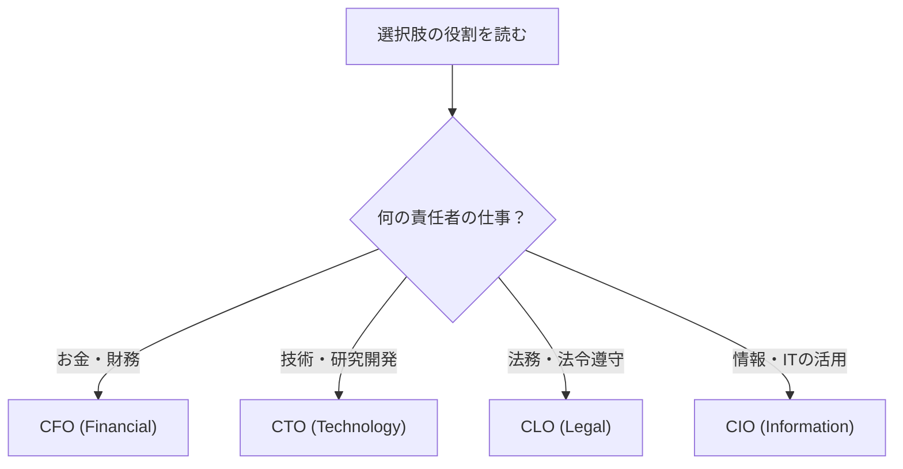

# CIOの役割：会社の「IT担当の参謀長」で覚える「ビジネス価値を最大化するIT活用」

> **想定読者**: CEO・CFO・CTO…とアルファベット役職が並ぶと混ざってしまう文系受験者  
> **省いたもの**: CxOの細かな組織論や企業ごとの呼称の違い  
> **所要時間**: 5〜6分  
> **対象過去問**: 応用情報技術者 平成30年秋期 午前問74

---

## 【対象過去問】平成30年秋期 問74

**【問題】**  
CIOが経営から求められる役割はどれか。

- **ア**: 企業経営のための財務戦略の立案と遂行
- **イ**: 企業の研究開発方針の立案と実施
- **ウ**: 企業の法令遵守の体制の構築と運用
- **エ**: ビジネス価値を最大化させるITサービス活用の促進

▶ 正解を表示する

**正解: エ（ビジネス価値を最大化させるITサービス活用の促進）**

---

## 0. 一枚で：『C◯Oは頭文字の「◯」で担当を当てる！I＝Information＝IT』

### 🧠 脳に刻む合言葉：
> **『 I は Information の I ！ITを経営に活かす人が CIO 』**

---

## 1. なぜそうなるのか？（日常のたとえ話：ラーメンチェーンの経営会議）

ラーメンチェーンの本部を想像してください。

- 社長(CEO)が「3年で100店舗にする」と決めました。
- このとき「注文アプリや在庫管理システムにいくら投資し、どう使えば売上が伸びるか」を考えて社長を支えるのが **CIO（最高情報責任者）** です。
- 「お金の工面」は経理の親分(CFO)、「新しいスープの開発」は技術の親分(CTO)、「法律違反が起きない仕組み」は法務の親分(CLO)の仕事です。

CIOは **経営戦略に沿った情報戦略やIT投資計画に責任を持つ役職** で、CEO（最高経営責任者）やCOO（最高執行責任者）を補佐し、企業の情報戦略を策定します。つまり「ITを導入すること」自体が目的ではなく、**ビジネス価値を最大化するためにITサービスを活用させる** ことが求められる役割です。

---

## 2. 選択肢のひっかけポイント ＆ 判定理由

| 選択肢 | 判定 | 理由（公式解説に基づく） |
|---|---|---|
| **ア** 財務戦略の立案と遂行 | ✕ | **CFO**（Chief Financial Officer：最高財務責任者）の役割。「お金」＝Financial。 |
| **イ** 研究開発方針の立案と実施 | ✕ | **CTO**（Chief Technology Officer：最高技術責任者）の役割。「技術」＝Technology。 |
| **ウ** 法令遵守の体制の構築と運用 | ✕ | **CLO**（Chief Legal Officer：最高法務責任者）の役割。「法律」＝Legal。 |
| **エ** ITサービス活用の促進 | ◯ | **CIO**の役割。情報戦略の責任者として、ITでビジネス価値を最大化する。 |

- **ひっかけ心理**: 「T（Technology）」と「I（Information）」が似て見えて、技術系の選択肢イに引っ張られやすい。CTOは「研究開発・技術」、CIOは「情報戦略・IT活用」と切り分ける。
- 「IT＝技術」という連想で選ばず、**頭文字の英単語で担当を引く** のが確実。

---

## 3. 午後試験 記述対策チェックリスト（※該当する場合）

- [ ] **Q. CIOの役割を説明せよ。**  
  → **「経営戦略に沿った情報戦略やIT投資計画に責任を持ち、IT活用でビジネス価値を最大化する。」**

---

## 🎯 次の2分アクション（定着チェック）

- [ ] **画面の一番上に戻り、正解を隠した状態で正解肢「エ」を確信を持って選べるか試してみよう！**
