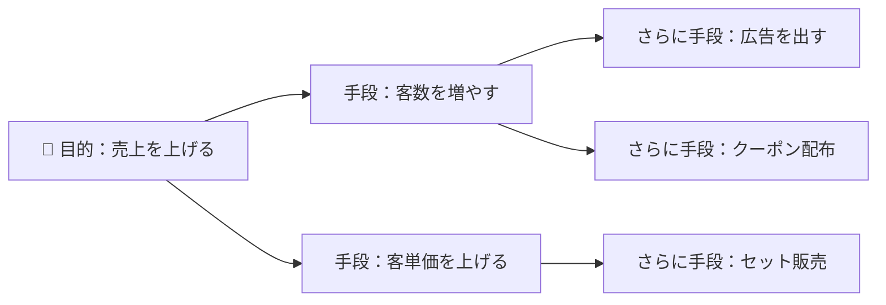

# 系統図法：お弁当づくりの「目的→手段」ツリーで覚える「系統図法」

> **想定読者**: 連関図・特性要因図・親和図・系統図が見分けられない文系受験者  
> **省いたもの**: 新QC七つ道具の他の手法（PDPC法・マトリックス図法など）の詳細  
> **所要時間**: 5〜6分  
> **対象過去問**: 応用情報技術者 令和3年春期 午前問76

---

## 【対象過去問】令和3年春期 問76

**【問題】**  
系統図法の活用例はどれか。

- **ア**: 解決すべき問題を端か中央に置き，関係する要因を因果関係に従って矢印でつないで周辺に並べ，問題発生に大きく影響している重要な原因を探る。
- **イ**: 結果とそれに影響を及ぼすと思われる要因との関連を整理し，体系化して，魚の骨のような形にまとめる。
- **ウ**: 事実，意見，発想を小さなカードに書き込み，カード相互の親和性によってグループ化して，解決すべき問題を明確にする。
- **エ**: 目的を達成するための手段を導き出し，更にその手段を実施するための幾つかの手段を考えることを繰り返し，細分化していく。

▶ 正解を表示する

**正解: エ（目的を達成するための手段を導き出し，更にその手段を細分化していく）**

---

## 0. 一枚で：『系統図＝目的を枝分かれさせて手段まで掘り下げる木！』

### 🧠 脳に刻む合言葉：
> **『 系統図は「目的→手段→さらに手段」の木。原因探しは別の図！ 』**

---

## 1. なぜそうなるのか？（日常のたとえ話：家系図ならぬ「手段の家系図」）

「今夜、家族を喜ばせる」という目的があるとします。

- 手段1「豪華な夕食を作る」→ さらに「肉料理にする」「デザートを付ける」
- 手段2「プレゼントを用意する」→ さらに「花を買う」「手紙を書く」

このように、**ご先祖（目的）から子・孫（手段・さらに具体的な手段）へ枝分かれ** させていくと、最後は「今日やること」にまで落とし込めます。これが系統図法です。公式解説では、**「目的－手段」の連鎖を段階的に下位に掘り下げることで最適な手段を見いだす図法** とされています。

---

## 2. 選択肢のひっかけポイント ＆ 判定理由

| 選択肢 | 判定 | 理由（公式解説に基づく） |
|---|---|---|
| **ア** 問題を中央に置き、要因を因果関係の矢印でつなぐ | ✕ | **連関図法** の活用事例。「原因と結果が絡み合う」ときに矢印で結ぶ。 |
| **イ** 結果と要因を整理して魚の骨の形にまとめる | ✕ | **特性要因図（フィッシュボーンチャート）** の活用事例。 |
| **ウ** カードに書いてグループ化する | ✕ | **親和図法（KJ法）** の活用事例。バラバラの意見を仲間分けする。 |
| **エ** 目的から手段を細分化していく | ◯ | **系統図法** の活用例。 |

- **ひっかけ心理**: ア・イはどちらも「原因」を探る図なので系統図と混同しやすい。系統図は原因探しではなく **「手段」を出す** ための図。
- キーワード対応：矢印で因果 → 連関図／魚の骨 → 特性要因図／カード → 親和図(KJ法)／目的→手段の枝分かれ → 系統図。

---

## 3. 午後試験 記述対策チェックリスト（※該当する場合）

- [ ] **Q. 系統図法とはどのような図法か。**  
  → **「目的を達成する手段を、目的－手段の連鎖で段階的に下位へ掘り下げ、最適な手段を見いだす図法。」**

---

## 🎯 次の2分アクション（定着チェック）

- [ ] **画面の一番上に戻り、正解を隠した状態で正解肢「エ」を確信を持って選べるか試してみよう！**
