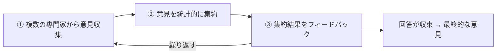

# デルファイ法：覆面の専門家会議で覚える「アンケートを繰り返して意見を収束」

> **想定読者**: デルファイ法・シナリオプランニング・回帰分析の違いが曖昧な文系受験者  
> **省いたもの**: 統計的集約に使う指標（中央値・四分位）の詳細  
> **所要時間**: 6〜8分  
> **対象過去問**: 応用情報技術者 令和4年秋期 問75  

---

## 【対象過去問】令和4年秋期 問75

**【問題】**  
予測手法の一つであるデルファイ法の説明はどれか。

- **ア**: 現状の指標の中に将来の動向を示す指標があることに着目して予測する。
- **イ**: 将来予測のためのモデル化した連立方程式を解いて予測する。
- **ウ**: 同時点における複数の観測データの統計比較分析によって将来を予測する。
- **エ**: 複数の専門家へのアンケートの繰返しによる回答の収束によって将来を予測する。

▶ 正解を表示する

**正解: エ（複数の専門家へのアンケートの繰返しによる回答の収束によって将来を予測する。）**

---

## 0. 一枚で：「専門家」「アンケート」「繰り返し」「収束」の4語！

### 🧠 脳に刻む合言葉：
> **『 デルファイ＝専門家へのアンケートを繰り返して、意見を収束！ 』**

---

## 1. なぜそうなるのか？（日常のたとえ話：覆面で行う「みんなの予想」会議）

「5年後のスマホ技術はどうなる？」を決めたいとき、会議で声の大きい人の意見に引っ張られがちです。そこで専門家に**アンケート用紙で別々に**答えてもらい、全員の回答のまとめ（統計）を配って「これを見て、もう一度答えてください」と何度か繰り返します。すると極端な意見が丸まり、意見が収束していきます。技術開発戦略の立案で将来の技術動向を予測する場面で使われる技法です（公式解説）。

---

## 2. 選択肢のひっかけポイント ＆ 判定理由

公式解説に基づく各選択肢の正体：

- **ア ✕（シナリオプランニングの説明）**: 現状の指標の中から将来の動向を示す指標に着目するのは、公式解説ではシナリオプランニングの説明とされています。
- **イ ✕（回帰分析の説明）**: モデル化した式を解いて予測するのは、公式解説では回帰分析の説明とされています。
- **ウ ✕（統計的予測理論の説明）**: 観測データの統計比較分析による予測は、公式解説では統計的予測理論の説明です。
- **エ ○（デルファイ法）**: 専門家・アンケートの繰り返し・回答の収束という3要素がそろっています。

| 手法 | 一言で言うと |
|---|---|
| デルファイ法 | 専門家アンケートを繰り返し、意見を収束 |
| シナリオプランニング | 将来のシナリオを描き予測する（選択肢アの説明） |
| 回帰分析 | 式（モデル）を使って予測する（選択肢イの説明） |

> 😈 ひっかけの構造：ア〜ウはどれも「予測手法の説明文」としてもっともらしい。**「専門家」「アンケート」「繰り返し」のキーワードがあるかどうか**で判断しましょう。

---

## 🎯 次の2分アクション（定着チェック）

- [ ] **画面の一番上に戻り、正解を隠した状態で正解肢「エ」を確信を持って選べるか試してみよう！**
- [ ] 「デルファイ＝専門家・アンケート・繰り返し・収束」を声に出して覚えよう。
