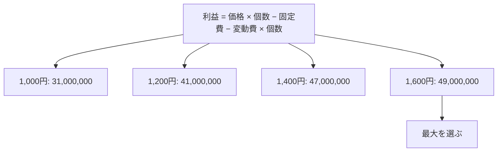

# 最大利益の価格設定：屋台のたこ焼きで覚える「価格×個数−固定費−変動費×個数」

> **想定読者**: 価格が高いほど儲かるのか安い方がよいのか、直感で選んでしまう文系受験者  
> **省いたもの**: 需要の価格弾力性などの経済学の理論  
> **所要時間**: 6〜8分  
> **対象過去問**: 応用情報技術者 令和4年春期 問76  

---

## 【対象過去問】令和4年春期 問76

**【問題】**  
新製品の設定価格とその価格での予測需要との関係を表にした。最大利益が見込める新製品の設定価格はどれか。ここで，いずれの場合にも，次の費用が発生するものとする。  
固定費：1,000,000円  
変動費：600円／個

> ※元の問題の表（設定価格と予測需要）は、公式解説の計算式から以下のように復元しました。

| 設定価格（円） | 予測需要（個） |
|---|---|
| 1,000 | 80,000 |
| 1,200 | 70,000 |
| 1,400 | 60,000 |
| 1,600 | 50,000 |

- **ア**: 1,000
- **イ**: 1,200
- **ウ**: 1,400
- **エ**: 1,600

▶ 正解を表示する

**正解: エ（1,600）**

---

## 0. 一枚で：「全部の価格で利益を計算して、一番大きいものを選ぶ」！

### 🧠 脳に刻む合言葉：
> **『 利益は 売上 − 費用。4通りとも計算して最大を選ぶ！ 』**

---

## 1. なぜそうなるのか？（日常のたとえ話：文化祭のたこ焼き屋）

たこ焼き屋の準備費（鉄板レンタル等）は何個売っても同じ**固定費**。たこ焼き1個ごとの材料費が**変動費**です。値段を上げると1個あたりの儲けは増えますが、客は減ります。**「1個の儲け × 売れる数」が最大になる点**を探すのがこの問題です。売上（売れた総額）が最大でも、利益が最大とは限りません。

### 途中計算（省略しません）

利益 ＝ 価格 × 販売個数 − 固定費 − 変動費 × 販売個数

1. 1,000円（80,000個）  
   1,000 × 80,000 ＝ 80,000,000  
   変動費 600 × 80,000 ＝ 48,000,000  
   80,000,000 − 1,000,000 − 48,000,000 ＝ **31,000,000**
2. 1,200円（70,000個）  
   1,200 × 70,000 ＝ 84,000,000  
   変動費 600 × 70,000 ＝ 42,000,000  
   84,000,000 − 1,000,000 − 42,000,000 ＝ **41,000,000**
3. 1,400円（60,000個）  
   1,400 × 60,000 ＝ 84,000,000  
   変動費 600 × 60,000 ＝ 36,000,000  
   84,000,000 − 1,000,000 − 36,000,000 ＝ **47,000,000**
4. 1,600円（50,000個）  
   1,600 × 50,000 ＝ 80,000,000  
   変動費 600 × 50,000 ＝ 30,000,000  
   80,000,000 − 1,000,000 − 30,000,000 ＝ **49,000,000**

最大は4.の49,000,000円なので、設定価格は1,600円です。

---

## 2. 選択肢のひっかけポイント ＆ 判定理由

- **ア 1,000円（利益31,000,000円）✕**: 一番たくさん売れるので「薄利多売で一番儲かりそう」と思わせる罠。1個あたりの儲けが 1,000 − 600 ＝ 400円しかなく、最下位です。
- **イ 1,200円（利益41,000,000円）✕**: 真ん中あたりの無難な選択に見えるが、4通り中3位。
- **ウ 1,400円（利益47,000,000円）✕**: 売上は1,200円のときと同じ84,000,000円。**売上が同じでも、販売個数が少ない分、変動費が減って利益は増える**ことに注意。ただし最大ではありません。
- **エ 1,600円（利益49,000,000円）○**: 1個の儲けが 1,600 − 600 ＝ 1,000円で、売上は80,000,000円と最大ではないが、費用が大きく減るため利益は最大。

> 😈 最大のトラップ：売上の最大値（1,200円と1,400円の84,000,000円）を見て「売上が大きい＝利益が大きい」と思い込むこと。利益は費用を引いて初めて比較できます。

---

## 🎯 次の2分アクション（定着チェック）

- [ ] **画面の一番上に戻り、正解を隠した状態で正解肢「エ」を確信を持って選べるか試してみよう！**
- [ ] 1個あたりの儲け（価格 − 600）× 個数 − 1,000,000 の形でも同じ結果になるか検算しよう（例：1,600円は 1,000 × 50,000 − 1,000,000 ＝ 49,000,000）。
