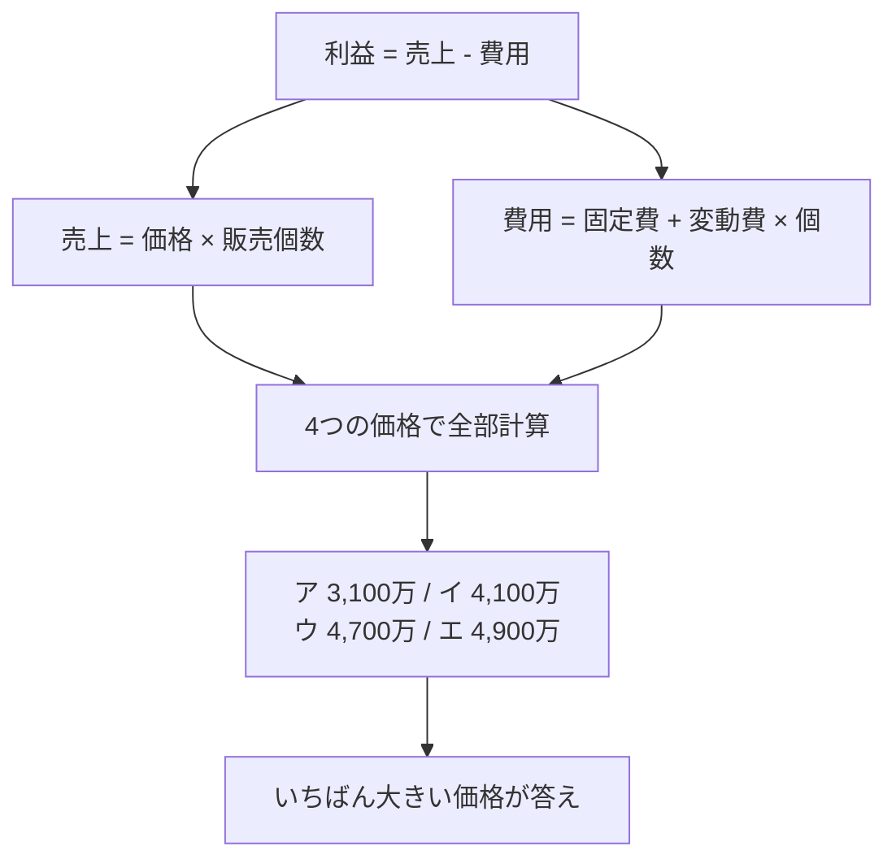

# 最大利益の価格設定：高く売れば儲かる…とは限らない！「価格×個数」の山を探す

> **想定読者**: 固定費・変動費の式は分かるが、価格ごとの売れ行きが絡むと混乱する文系受験者  
> **省いたもの**: 需要曲線・価格弾力性の経済学的な理論  
> **所要時間**: 6〜8分  
> **対象過去問**: 応用情報技術者 平成26年秋期 午前問77  

---

## 【対象過去問】平成26年秋期 問77

**【問題】**  
最大利益が見込める新製品の設定価格はどれか。ここで，いずれの場合にも，次の費用が発生するものとする。  
固定費：1,000,000円  
変動費：600円／個

- **ア**: 1,000
- **イ**: 1,200
- **ウ**: 1,400
- **エ**: 1,600

> 📝 **復元に関する注記**: 原問題には「設定価格ごとの予測販売個数」の表が付いていますが、取得データの問題文には含まれていません。公式解説の計算式から、ア〜エの価格に対応する販売個数は **1,000円→80,000個、1,200円→70,000個、1,400円→60,000個、1,600円→50,000個** と復元できます（表そのものの体裁は未復元）。

▶ 正解を表示する

**正解: エ（1,600）**

---

## 0. 一枚で：『利益＝価格×個数−固定費−変動費×個数。4つ全部計算して比べる！』

### 🧠 脳に刻む合言葉：
> **『 価格が高い＝売れ個数が減る。だから全部計算して最大を選ぶ！ 』**

---

## 1. なぜそうなるのか？（日常のたとえ話：文化祭のたこ焼き屋）

たこ焼きを1個100円で売れば大行列、300円なら閑古鳥…。安くすればたくさん売れますが、1個あたりの儲けは薄い。高くすれば1個の儲けは大きいが、売れる数が減る。**「1個の儲け×売れる数」が最大になる点**が、最大利益の価格です。

材料費など個数に比例するのが変動費、屋台のレンタル料のように売れても売れなくても固定でかかるのが固定費です。

### 途中計算（公式解説に基づく・省略なし）
利益 ＝ 価格×販売個数 − 固定費 − 変動費×販売個数

- **ア（1,000円・80,000個）**  
  1,000×80,000 − 1,000,000 − 600×80,000  
  ＝ 80,000,000 − 1,000,000 − 48,000,000 ＝ **31,000,000円**
- **イ（1,200円・70,000個）**  
  1,200×70,000 − 1,000,000 − 600×70,000  
  ＝ 84,000,000 − 1,000,000 − 42,000,000 ＝ **41,000,000円**
- **ウ（1,400円・60,000個）**  
  1,400×60,000 − 1,000,000 − 600×60,000  
  ＝ 84,000,000 − 1,000,000 − 36,000,000 ＝ **47,000,000円**
- **エ（1,600円・50,000個）**  
  1,600×50,000 − 1,000,000 − 600×50,000  
  ＝ 80,000,000 − 1,000,000 − 30,000,000 ＝ **49,000,000円**

---

## 2. 選択肢のひっかけポイント ＆ 判定理由

- **ア（1,000円）: ✗**  
  → 最も売れる（8万個）が1個あたりの儲けは400円と薄く、利益は3,100万円で最下位。「薄利多売で一番儲かりそう」という心理トラップ。
- **イ（1,200円）: ✗**  
  → 利益4,100万円。売上は8,400万円と大きいが、変動費が4,200万円かかり利益はウ・エに届かない。
- **ウ（1,400円）: ✗**  
  → 利益4,700万円。**売上はイと同じ8,400万円**で、個数が減った分だけ変動費が減るため利益が増える。惜しいが最大ではない。
- **エ（1,600円）: ○**  
  → 利益4,900万円で最大。売上は8,000万円と一番低いが、変動費が3,000万円まで下がるため利益は最大になる。

> ⚠️ 「売上が最大＝利益が最大」ではない！売上最大はイとウ（8,400万円）ですが、利益最大はエ。必ず費用を引いて比べます。

---

## 3. 午後試験 記述対策チェックリスト（※該当する場合）

- [ ] **Q. 利益を求める式を、固定費・変動費を使って示せ。**  
  → **「利益＝売上高−（固定費＋変動費×販売個数）で求める。」**

---

## 🎯 次の2分アクション（定着チェック）

- [ ] **画面の一番上に戻り、正解を隠した状態で正解肢を確信を持って選べるか試してみよう！**
