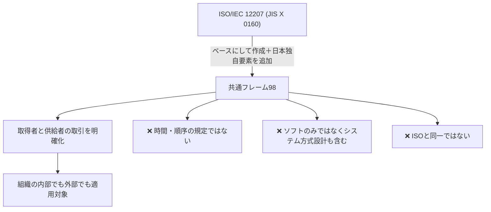

# 共通フレーム98：取引の「共通の物差し」で覚える「社内取引もOK」

> **想定読者**: 共通フレームとISO/IEC 12207の関係や、規定範囲があいまいな文系受験者  
> **省いたもの**: 各プロセスの細かな一覧  
> **所要時間**: 5〜6分  
> **対象過去問**: 応用情報技術者 平成18年秋期 午前問78

---

## 【対象過去問】平成18年秋期 問78

**【問題】**  
共通フレーム98(SLCP-JCF98)が規定しているものはどれか。

- **ア**: 開発プロセスでは，ソフトウェアライフサイクルを構成する作業の時間及び順序を規定している。
- **イ**: 顧客と開発ベンダーの受注契約にかかわる取引以外に，社内の部門間取引も対象に規定している。
- **ウ**: ハードウェアを含めた業務システムの開発プロセスではなく，ソフトウェア開発のプロセスを対象に規定している。
- **エ**: プロセスのくくりとプロセス自体をISO/IEC 12207(JIS X 0160)と同一に規定している。

▶ 正解を表示する

**正解: イ（顧客と開発ベンダーの受注契約にかかわる取引以外に，社内の部門間取引も対象に規定している）**

---

## 0. 一枚で：『共通フレーム＝取得者と供給者の共通の物差し。社内でも社外でも使える！』

### 🧠 脳に刻む合言葉：
> **『 共通フレームは共通の物差し。社内取引も対象、ISOとは同一じゃない 』**

---

## 1. なぜそうなるのか？（日常のたとえ話：引っ越しの「見積書の共通書式」）

引っ越しで、業者ごとに見積書の書き方がバラバラだと比較できません。そこで「項目名と作業の区切りはこの書式で統一」というルールがあれば、頼む側も請ける側も同じ物差しで話せます。共通フレームはまさにこの **ソフトウェア取引の共通書式** です。

公式解説では、ソフトウェア産業界における「共通の物差し」を目的に、ISO/IEC 12207をベースに作られた規格で、取得者と供給者双方（システム開発に関わる全員）が、企画・要件定義・開発・運用・保守の作業内容を共通に参照できるようにし、ソフトウェア取引を明確化する基準が記述されています。

「取得者」と「供給者」は、**会社対会社でも、同じ会社の部署対部署でもよい** ので、組織の内部か外部かを問わず、システム・ソフトウェアを取得／供給するときは適用対象になります。

---

## 2. 選択肢のひっかけポイント ＆ 判定理由

| 選択肢 | 判定 | 理由（公式解説に基づく） |
|---|---|---|
| **ア** 作業の時間及び順序を規定 | ✕ | 工程や時間に依存して定義されたものではない。「何をするか」の作業内容の物差しであり、「いつ・どの順で」を縛るものではない。 |
| **イ** 社内の部門間取引も対象 | ◯ | 組織の内部か外部かを問わず、システム・ソフトウェアを取得／供給するときは適用対象。 |
| **ウ** ソフトウェア開発のみが対象 | ✕ | ソフトウェア、ハードウェア、手作業を含むシステム方式設計の工程が含まれる。さらにソフトウェアを中心としたシステム関連作業まで含む。 |
| **エ** ISO/IEC 12207と同一 | ✕ | 日本独自の要素が追加されているので同一ではない。 |

- **ひっかけ心理**: 「ISOがベース」という知識から、エの「同一」を選びやすい。**ベース≠同一**（日本独自要素の追加あり）。
- ウは「ソフトウェア」という名前に引っ張られる罠。範囲はシステム全体寄り。
- アはウォーターフォールの工程順のイメージで「順序も決めている」と思い込む罠。

---

## 3. 午後試験 記述対策チェックリスト（※該当する場合）

- [ ] **Q. 共通フレームの目的を述べよ。**  
  → **「ソフトウェア産業界の共通の物差しとして、取得者と供給者が作業内容を共通に参照し、取引を明確化すること。」**

---

## 🎯 次の2分アクション（定着チェック）

- [ ] **画面の一番上に戻り、正解を隠した状態で正解肢「イ」を確信を持って選べるか試してみよう！**
